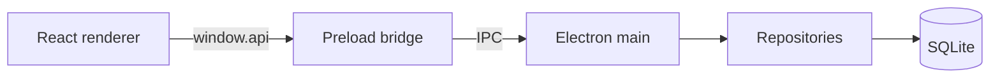

# House Budget

A local-first, zero-based budgeting app for households. Plan every unit of income into groups and items each month, log what you actually spend, and see where the money went, all on your own machine with no accounts, no cloud, and no subscriptions.

House Budget is a desktop app built with Electron, React, and SQLite. Your data lives in a single SQLite file on your computer and never leaves it.

## Why House Budget

- **Zero-based budgeting** — every month you give every unit of income a job until income minus allocations reaches zero.
- **Built for households** — track income per member, and plan funding across multiple bank accounts (main, joint, wallet, savings).
- **Local-first and private** — no sign-up, no telemetry, no network calls. The whole budget is one SQLite file you own.
- **Plan vs. actual** — record individual spending entries against each item and watch the difference update live.
- **History and dashboard** — review past months and visualise trends with built-in charts.
- **Safe by default** — automatic backups on close (when enabled) plus on-demand snapshots.

## Requirements

- [Node.js](https://nodejs.org/) 18 or newer (includes npm)
- Windows. This is the only platform that has been built and tested; the packaged build ships an NSIS installer. macOS and Linux are untested and may need extra work.
- A C/C++ toolchain (Visual Studio Build Tools on Windows) is needed once to compile the native `better-sqlite3` module.

## Installation

```bash
git clone https://github.com/JoseSilva1997/zero-based-budget-app.git
cd house_budget
npm install
```

If the native SQLite module needs rebuilding against Electron's Node version:

```bash
npm run rebuild
```

## Quickstart

Run the app in development mode (compiles the main process, starts the renderer bundler in watch mode, and launches Electron):

```bash
npm run dev
```

After editing a renderer file (`.jsx`), save and press <kbd>Ctrl</kbd> + <kbd>R</kbd> in the app window to reload. Editing main-process TypeScript requires restarting `npm run dev`.

To run a one-off production-style build and launch:

```bash
npm start
```

On first launch the app creates an empty SQLite database under your user data folder, then you can add household members, create your first month, and start allocating.

## Usage

The app has four screens, reachable from the sidebar:

- **Dashboard** — an at-a-glance overview with charts (powered by Recharts).
- **Month Budget** — the core view: income by member, then allocation groups and items, with allocated / actual / difference columns. Open the **Wallet** sheet to plan funding by bank account.
- **History** — browse and reopen previous months.
- **Settings** — manage household members, bank accounts, currency, theme, and backups.

A typical monthly flow:

1. Create a new month from **Month Budget → New month**.
2. Enter each household member's income for the month.
3. Add groups (for example House, Food, Savings) and items within them, giving each a planned amount.
4. As money is spent, log actual entries against the relevant items.
5. Check the **difference** column to keep the month balanced.

## Configuration

There is nothing to configure to get started, the app works out of the box. Preferences such as currency, theme, household members, bank accounts, and backup behaviour are all managed in the **Settings** screen and stored in the database.

### Data and backups

All data is stored under Electron's per-user data directory:

- `data/budget.sqlite` — the live database.
- `backups/` — dated database snapshots.
- `cloud-backup.json` — this machine's cloud backup folder setting (see below).

The exact location is printed to the console at startup (`[house-budget] userData: …`). Development launches use a separate folder; see [Development data folder](#development-data-folder). When auto-backup is set to "on close", the app writes a snapshot when you quit (an empty, never-used database is skipped). You can also take manual backups from **Settings**.

### Cloud backup folder

**Settings → Data & backup → Cloud backup folder** copies every backup to a folder that a sync app uploads for you. The app never talks to a cloud service itself, so there's no account to create and no credentials to store.

- **Local first.** Each backup is saved in `backups/` first and only then copied. If the copy fails (folder missing, drive not mounted), the local backup still counts, Settings shows why, and the app tries again at the next backup or startup.
- **Layout.** The app creates a `House Budget` folder inside the one you pick, with one subfolder per device. Each device keeps only its last 30 backups there and never touches the others.
- **Restoring.** The restore list shows this device's backups and, under *Cloud folder*, backups from other devices or ones no longer on this device. A cloud backup is copied locally and checked before anything is replaced.
- **New computer.** Install your sync app and House Budget, choose the same folder (or the `House Budget` folder inside it), and restore from the list.

Which sync app to use:

- **Windows:** OneDrive is built in. Dropbox and Google Drive for desktop also work.
- **Linux:** any tool that gives you a synced folder or a mount — Dropbox (official client), [Nextcloud](https://nextcloud.com/install/#desktop-files), [onedrive](https://github.com/abraunegg/onedrive), [rclone](https://rclone.org/) (`rclone mount --vfs-cache-mode writes`, or a scheduled `rclone copy`), or [Syncthing](https://syncthing.net/) to sync to your own devices.

The app can only confirm the copy reached the folder, not that your sync app has uploaded it yet.

## Building a distributable

```bash
npm run pack   # unpacked build into release/ (for testing)
npm run dist   # full installer (Windows NSIS) into release/
```

A local build is versioned `0.0.0`: the real version is stamped in by CI (see below), so `package.json` never needs bumping by hand.

## Branches and releasing

Two long-lived branches, and both only change through pull requests:

| Branch | What it is | Merging into it |
|--------|------------|-----------------|
| `staging` (default) | Where work gathers between releases. | Feature branches and Dependabot. Releases nothing. |
| `main` | Exactly what users have. | Only release PRs from `staging`. Every merge is a release. |

```
feat/x ──PR──▶ staging ──release PR──▶ main ──▶ tagged GitHub release ──▶ installed copies update
dependabot ─PR─┘   │
                   └──▶ staging build (installer + AppImage, workflow artifacts)
```

1. **Develop.** Branch off `staging` and open a pull request back into it. CI runs the suites on Linux and Windows, and the PR cannot merge until both pass. Squash or merge commit, either is fine. Nothing is released until you decide it is time.
2. **Try it.** Every push to `staging` runs the **Staging build** workflow, which leaves a Windows installer and a Linux AppImage on the run as artifacts for 14 days. Run the workflow by hand to get one for any other branch. A staging build is its own app, *House Budget Staging*, versioned like `1.2.1-staging.42`: it installs beside the real one with its own data folder, and never offers or installs updates.
3. **Release.** First review the open Dependabot pull requests and merge them into `staging`. Then open a pull request from `staging` into `main`, titled with a version prefix (below). It needs the suites, the **Release source** check (the PR comes from `staging`) and the **Version prefix** check to pass, and `staging` to be up to date with `main`. Merge it with a **merge commit**, the only method `main` allows. A squash would leave `main` with a commit `staging` lacks, and every later release PR would conflict.
4. **Publish.** The **Release** workflow tags the merge commit, builds the Windows installer and the Linux AppImage in parallel, and publishes the GitHub release once both are uploaded. Installed copies then offer the update.

The release PR's title picks the version bump (case-insensitive; a scope like `med (ui):` is fine). A title without one of these fails the **Version prefix** check, and the pull request cannot merge until it is renamed. Pick the largest change in the batch:

| Title starts with | Bump | Example |
|-------------------|------|---------|
| `maj:` | major | 1.4.2 → 2.0.0 |
| `med:` | minor | 1.4.2 → 1.5.0 |
| `min:` | patch | 1.4.2 → 1.4.3 |

Pull requests into `staging` need no prefix.

Dependabot (`.github/dependabot.yml`) opens its pull requests against `staging` once a week: one grouped PR for security updates, one for minor and patch updates, and one PR per major version bump. They wait there until release time, when you review and merge them before opening the release PR.

The git tags are the record of what has shipped: the next version is the highest `vX.Y.Z` tag, bumped. A merge that only touches Markdown, `LICENSE`, `tests/` or `.github/` is not released. To release one anyway, or to retry a failed release, run the **Release** workflow by hand from the Actions tab.

## Development

| Command | Description |
|---------|-------------|
| `npm run dev` | Full dev loop: build main/preload, watch-build the renderer, launch Electron. |
| `npm run build` | Compile main + preload TypeScript (`tsc`). |
| `npm run build:renderer` | Bundle the renderer with esbuild. |
| `npm run watch:renderer` | Rebuild the renderer on save. |
| `npm run rebuild` | Rebuild the native `better-sqlite3` module for Electron. |
| `npm start` | Build everything, then launch Electron. |
| `npm test` | Build, then run the Electron test suites in `tests/`. |
| `npm run dev:update` | Dev loop with a faked update, to see the update banner. |
| `npm run dev:update:downloaded` | As above, starting from an update that is ready to install. |

### Development data folder

`npm run dev` and `npm start` (any launch where Electron is not packaged) keep
their data in their own folder, **House Budget Dev**, beside the installed app's:

- Linux: `~/.config/House Budget Dev`
- Windows: `%APPDATA%\House Budget Dev`

So a branch with a newer database schema migrates only this copy, never the
installed app's database (`~/.config/house-budget` / `%APPDATA%\house-budget`),
which the installed release could then no longer open. Staging builds do the
same as *House Budget Staging*.

To open the real data on purpose, set `HB_REAL_DATA=1`. The app then migrates
it to this branch's schema, so back it up first:

```bash
HB_REAL_DATA=1 npm start
```

In PowerShell: `$env:HB_REAL_DATA=1; npm start`. An explicit
`--user-data-dir=<folder>` (as the screenshot skill passes) always wins, and the
tests set their own folder.

### Seeing the update banner

Updates are never downloaded on their own: a check reports that a version is
available, and the banner at the foot of the sidebar offers a **Download**
button. Since that needs a newer published release to happen for real, dev
builds can fake the whole sequence:

```bash
npm run dev:update
```

Roughly five seconds after launch the banner offers an update; Download shows
a progress bar, and the finished download offers **Restart now** (which only
logs, and never installs anything). Other scenarios have their own scripts:

```bash
npm run dev:update:downloaded   # skip straight to a pending install
npm run dev:update:none         # "you are running the latest version"
npm run dev:update:error        # a failed check
```

The terminal names every status as it is pushed (`[updater] SIMULATION pushed
"downloaded"`), which is the quickest way to tell a missing check from a
missing banner.

`npm run dev -- --update-sim=<scenario>` works too, including in PowerShell,
where the `--` separator is dropped and npm keeps the flag as a config of its
own: the app reads `npm_config_update_sim` as a fallback. Setting
`HB_UPDATE_SIM` directly always works.

Settings › Updates shows the same statuses in words, including the errors the
banner deliberately stays quiet about. Simulation is refused in packaged
builds.

### Project structure

```
main/        Electron main process: entry point, DB init, IPC handlers
preload/     Context-isolated bridge exposing window.api to the renderer
renderer/    React UI (screens, components, store, lib helpers)
database/    SQL schema, triggers, migrations, repositories, conversions
scripts/     Build, dev, icon, and native-rebuild helpers
```

### Architecture



The renderer never touches the database directly. It calls atomic methods on `window.api`, which the context-isolated preload forwards over IPC to handlers in `main/ipc`. Those handlers go through repositories in `database/` that read and write the SQLite file. Monetary values are stored as integer cents to avoid floating-point error.

### Schema and migrations

The committed `database/schema.sql` and `database/triggers.sql` are the baseline (version 1). Schema changes are append-only, numbered migrations in `database/migrations.ts`, applied automatically on startup via SQLite's `PRAGMA user_version`. Never edit a shipped migration, add a new one.

## Contributing

Issues and pull requests are welcome. To get set up, follow [Installation](#installation), then run `npm run dev`. When changing the database schema, add a new migration rather than editing the baseline or an existing migration.

Each feature has a living doc in [`docs/features/`](docs/README.md), and each feature PR comes with a spec, its key decisions and a short overview, named by PR number. New to the code? Start with the feature docs.

## License

[MIT](LICENSE)
