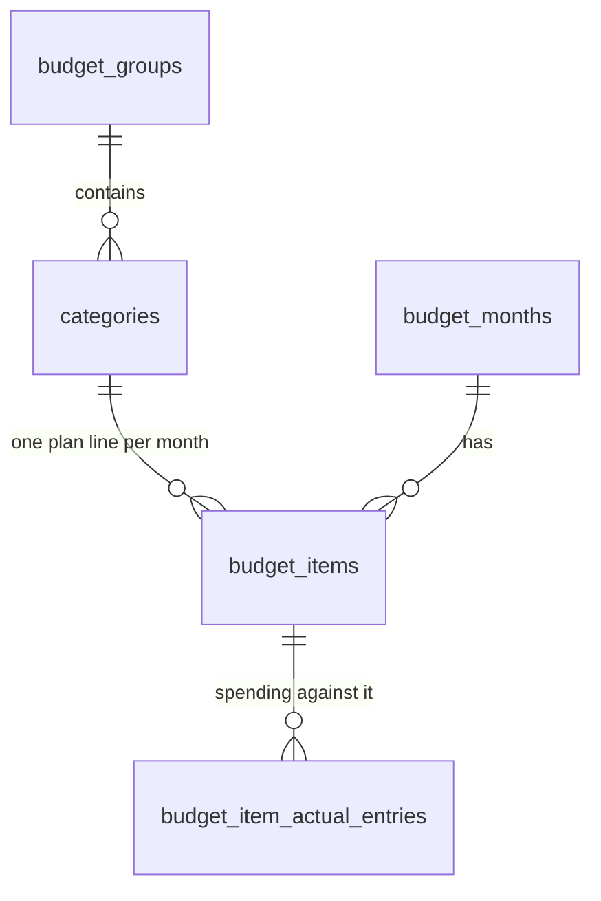

# Feature: categories

**PRs:** [#32](../pr-overview/pr32-categories_overview.md) · **Used by:** [upload transactions](upload-transactions_feature.md)

## Context

A budget line such as "Groceries" recurs every month, but the app used to store each month's copy as an unrelated row: starting a month cloned the previous month's groups and items with new IDs. Nothing could follow "Groceries" across months. That made renaming tedious, left duplicates impossible to clean up, and blocked any feature that learns from history, such as suggesting a category for a bank transaction.

## What it does

- Each budget line belongs to a **category** that is the same in every month. A month has one **plan line** per category (its planned amount that month).
- **Renaming or moving** a line changes the category in every month, past ones included.
- Adding a line or group by a name that already exists **reuses** it rather than creating a duplicate.
- **Settings → Categories** lists every category with its usage, and lets you:
  - **archive** one (hidden from pickers and new months, history kept)
  - **merge** one into another (the impact is shown first, and a backup is taken before writing)

## How it works

- **Groups** ("Daily living") are shared by all months.
- **Categories** ("Groceries") belong to a group and are shared by all months.
- **Plan lines** (`budget_items`) are one category's planned amount in one month, unique per (month, category).
- **Entries** record spending against a plan line, so each entry knows both its month and its category.

| You do | What happens |
|---|---|
| Rename or move a line | The category changes in every month |
| Delete a line from a month | Only that month's line goes; the category is deleted once nothing uses it |
| Delete a group from a month | That month's lines go; the group is archived if other months use it, deleted otherwise |
| Archive a category | Hidden from pickers and new months; history kept |
| Merge A into B | Lines and entries move to B; same-month lines are summed; A is deleted |
| Start a new month | Copies the plan lines of non-archived categories |

Existing databases were converted by migration 8, which runs after an automatic backup. It merges per-month copies by name and keeps every entry attached.

## Where the code lives

| Area | Files |
|---|---|
| Schema and migration | `database/schema.sql`, `database/migrations.ts` |
| Category rules (rename, prune, archive, merge) | `database/repositories/categories.ts` |
| Month reads and writes | `database/repositories/months.ts` |
| IPC | `main/ipc/categories.ts`, `main/ipc/groups.ts`, `main/ipc/items.ts` |
| UI | `renderer/Settings.jsx` (Categories), `renderer/MonthGroups.jsx`, `renderer/store.jsx` |

## Limits and what's parked

- Groups can't be merged; renaming a group into an existing name is refused.
- A category's name and group can't differ between months.
- A merge can only be undone by restoring the backup it takes.

## PRs

1. [#32](../pr-overview/pr32-categories_overview.md): month-independent groups and categories, migration 8, archive and merge.

## Changelog

| Date | PR | Change |
|---|---|---|
| 2026-10-18 | #32 | Feature introduced. |
