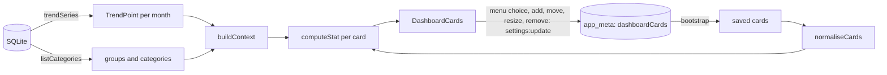

# Feature: dashboard

**Changes:** [cards](../key-decisions/2026-10-31-dashboard-cards_decisions.md)

## Context

The Dashboard is where a household sees its habits over time: how much it puts aside, how its spending moves, how well it sticks to its plan. It is not a second view of the current month; the Month Budget screen does that.

The first version had a fixed headline (saved all time, share of income kept back, a typical month's spend), a "Category trends" list and a "Runs over most often" list. The Engineer found the two lists useless and the headline too fixed, and asked for cards the household chooses instead.

## What it does

- **Cards across the top, on a grid you arrange.** The grid is 4 columns wide and up to 3 rows deep, and each card covers a rectangle of cells, from one cell to the whole grid. Only the rows the cards reach take space, so the cards can fill one row, two or three. There can be no cards at all.
- **A card's size is its weight.** Its figure is drawn at one of three sizes by how many cells it covers: one cell, two cells, or three and more (the largest also wears the accent).
- **Editing.** **Edit cards** in the screen's header shows all three rows, with each free cell drawn as a dashed box:
  - click a free cell, or drag across several, to add a card that size; its menu opens to choose the stat
  - drag a card to move it, or its corner to resize it
  - with the keyboard, a card takes focus; the arrows move it, Shift and the arrows resize it, and Delete (or its × button) removes it

  A move or resize that would leave the grid or cover another card is not made; while dragging, the drop outline turns red and hatched where it would not fit. Every change is saved as it happens. **Done** ends editing.
- **Each card has a menu** (shown on hover or focus) listing every stat, grouped under Saving, Spending, The plan and Income. Picking one changes that card, and the choice is remembered.
- **Some stats ask for a choice** after they are picked, in the same menu:
  - a **group or category** (Average monthly spend on…, Total spent in the last 12 months on…, Share of spending on…). Spend groups are listed with their categories under them; savings groups are not spending, so they are not offered.
  - a **savings goal** (Saved toward a goal).
  - a **share of income** (Longest run saving a share of income), from 5% to 30%.

  The same stat can be on more than one card with different choices, such as spending on Groceries and on Eating out.
- **The charts below:** Saved each month, Savings by goal adding up, Planned against spent, and When money leaves in the month. They show the last 12 months, the current one included.

### The stats

| Section | Stat | Reads |
|---|---|---|
| Saving | Saved, all time | every month up to this one |
| | Saved this year | this calendar year up to this month |
| | Average share of income saved | window |
| | Median share of income saved | window |
| | Best month for saving | window |
| | Longest run saving a share of income | window |
| | Saving lately, against before (last 3 months against the 9 before) | window |
| | Saved toward a goal | every month up to this one |
| Spending | Average monthly spend, with savings | window |
| | Median monthly spend, with savings | window |
| | Average monthly spend, without savings | window |
| | Median monthly spend, without savings | window |
| | Average monthly spend on a group or category | window |
| | Median monthly spend on a group or category | window |
| | Total spent in the last 12 months on a group or category | window |
| | Share of spending on a group or category | window |
| | Where most of the money goes (the group with the largest share) | window |
| | Average share of income spent | window |
| | Median share of income spent | window |
| | How much monthly spending swings (lightest and heaviest month) | window |
| | Day half the month's spending has gone | window |
| | Purchases a month | window |
| | Median purchases a month | window |
| | Average purchase size | window |
| | Median purchase size (the middle of every purchase in the window) | window |
| | Share of spending at weekends | window |
| The plan | Months within the plan | window |
| | Longest run within the plan | window |
| | How close spending lands to the plan (average gap, as a share of the plan) | window |
| | How close spending lands to the plan, median | window |
| | Average overspend, in the months that went over | window |
| | Median overspend, in the months that went over | window |
| Income | Average monthly income | window |
| | Median monthly income | window |
| | Income against the year before (the window against the 12 months before it) | window and the 12 before |

Every average has a **median** twin listed right after it. An average is pulled a long way by one odd month (a holiday, a boiler); the median is what a usual month looks like. With an even number of months it is halfway between the middle two.

The defaults are Saved all time covering two columns and two rows, Average share of income saved and Average monthly spend with savings in one cell each beside it, and Months within the plan two columns wide under those.

## How it works

- **Which months count.** "All time" and "this year" stats add every month up to and including the current one, never a month planned ahead. Every other stat reads the **window**: the last 12 *finished* months, meaning months before the current calendar month. The month in progress is half a month and would always look light and within plan. Inside the window a stat counts only the months that have what it measures (spending, income, or a plan with spending), so an untracked month is not read as a month of no spending.
- **What "spending" means.** Money out of spend and debt groups. What went into a savings group is put aside, not spent, so it is left out of every spending stat except "with savings". The plan stats compare the whole plan with everything entered, savings included, because that is what the plan is.
- **Too little to go on** shows a dash and says what the stat is waiting for, rather than a zero that reads as a fact.
- **Data.** `trendSeries` returns, per month, what the charts read plus what only the cards read: `savingsActual`, spending by group and category **id** (`byGroupId`, `byCategoryId`, so a chosen group survives a rename), `savingsByCatId`, `purchases`, `purchaseTotal` and `purchaseAmounts` (spends outside savings, refunds not counted; the amounts are for the median purchase), `weekendSpend`, and `spendByDay` without savings. `listCategories` now carries each category's `groupKind`.
- **The saved cards** are JSON in `app_meta` under `dashboardCards`, written through `settings:update`: a list of `{ stat, of?, goal?, percent?, x, y, w, h }`, where `x`, `y` is the top-left cell (from 1) and `w`, `h` the columns and rows it spans. The main process checks only the shape (at most twelve cards, each naming a stat, inside the grid, none overlapping, with any choice in the right form) and refuses anything else. The stat ids belong to the renderer: a card with an id it does not know keeps its place and asks for a stat. An unreadable saved value reads as "none chosen", which means the defaults; an empty list is a choice and stays empty.
- **The grid's rules** (`renderer/lib/cardGrid.js`) are pure functions: whether a rectangle fits, moving, resizing, the rectangle between two cells, the free cells, and a card's size rung. A drag reads the cell under the pointer from the grid's resolved tracks, so rows of different heights are measured as drawn.

## Where the code lives

- `renderer/Dashboard.jsx`: the screen.
- `renderer/DashboardCards.jsx`: the cards, their menu, and editing.
- `renderer/lib/cardGrid.js`: the grid's rules.
- `renderer/lib/dashboardStats.js`: every stat's arithmetic, the defaults, `normaliseCards`, `buildContext`.
- `renderer/DashboardCharts.jsx`: the charts.
- `database/repositories/months.ts` (`trendSeries`), `database/repositories/dashboardCards.ts`, `main/ipc/settings.ts`.
- `renderer/styles/charts.css`.
- Tests: `tests/dashboard-electron.cjs`.

## Limits and what's parked

- The grid is fixed at 4 columns and 3 rows, and does not reflow on a narrow window: the cards narrow with it and their text wraps.
- Moving a card onto another does not swap them; the move is refused.
- The window is fixed at the last 12 finished months; there is no period picker.
- A card pointing at a group or category that was deleted or merged away shows a dash until another is chosen.
- The charts still include the month in progress; only the cards leave it out.

## Changelog

| Date | Commit | What changed |
|---|---|---|
| 2026-10-31 | cards | Cards the household picks and arranges on a 4 × 3 grid replace the fixed headline; "Category trends" and "Runs over most often" removed; Saved each month made full width. |
