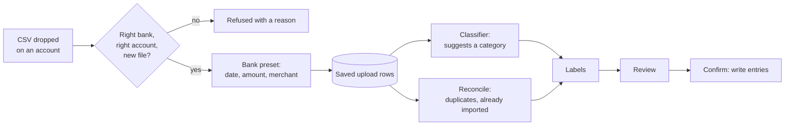
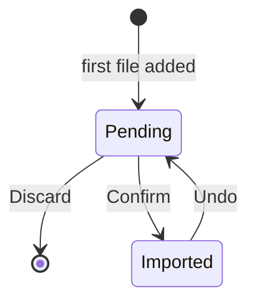

# Feature: upload transactions

**PRs:** [#32](../pr-overview/pr32-categories_overview.md) (groundwork) · [#33](../pr-overview/pr33-upload-transactions_overview.md) · **Builds on:** [categories](categories_feature.md)

## Context

Every actual entry used to be typed by hand: a month of spending across several bank accounts meant dozens of entries, each a chance for a typo or a missed transaction. The banks already have that data and export it as CSV. The Engineer wanted the app to read those exports, but still to see and approve every row before anything reaches the budget.

## What it does

- **Upload transactions** in Month Budget opens a large overlay with a drop zone for each account. You drop the CSV statements downloaded from the bank.
- Supported banks: **Monzo, Lloyds, Revolut, NatWest**. Monzo's shorter export (ID, Created, Title...) is read too, and a Lloyds export with only some of its columns chosen.
- The app reads every transaction and suggests a category, learning from earlier uploads. It flags anything that needs attention:
  - possible duplicates of entries you already typed
  - transactions already imported
  - transactions outside the month
  - money in
- You review one list, fix what's wrong, and press **Confirm** once. The entries are written together.
- **Same as existing** links a bank row to an entry you already typed instead of creating a new one, and teaches the classifier.
- **Notes.** The pencil in a row's actions opens a note under it, written onto the entry on Confirm. A matched row, a transfer or a blocked row takes none, since it writes no entry.
- **Teach without importing.** Pick a category for a row and leave it unticked: Confirm writes no entry for it, but the classifier learns its category. The footer counts these ("3 to learn from"), and Confirm works even when they are all there is.
- **Undo** reverses an upload, removing only the entries it created.

## How it works

- **Banks.** Each account is linked once to a bank. A built-in preset per bank turns its CSV into the same row shape. A preset recognises its bank by the columns it requires and the ones it may also write, so an export that leaves optional columns out (Lloyds without its account or balance) still matches; without account columns, the statement isn't checked against the account. Monzo's shorter export has no transaction type, so a pot move is recognised as two rows with the same title, opposite amounts and the same minute, and dropped.
- **Classifier.** Runs locally (TF-IDF + nearest neighbours) and learns from confirmed rows, "Same as existing" links, rows marked as transfers, and unticked rows whose category you picked. A category it guessed itself never teaches it. It depends on [categories](categories_feature.md): it predicts a category that means the same thing in every month.
- **Labels** decide each row's default (ticked or not) and are colour-coded by severity: amber for "check this", red for "can't be imported".
- **Lifecycle.** Each month has at most one pending upload, saved until you confirm or discard it.

## Where the code lives

| Area | Files |
|---|---|
| Reading CSVs and presets | `main/import/csv.ts`, `main/import/presets/`, `main/import/clean.ts` |
| Fingerprint, classifier, labels | `main/import/fingerprint.ts`, `classifier.ts`, `labels.ts`, `pipeline.ts` |
| Saved uploads | `database/repositories/imports.ts`, `database/repositories/banks.ts` |
| IPC | `main/ipc/imports.ts` (contract in its header) |
| UI | `renderer/Upload.jsx`, `renderer/lib/imports.js`, `renderer/styles/upload.css` |

## Limits and what's parked

- **Formats:** CSV only, and only the four banks above.
- **Duplicate matching:** needs the exact same amount within 3 days. An entry typed with a different amount or date, or one entry covering two bank rows, isn't found and can't be matched yet.
- **Refunds and credits** never become entries.
- **Splitting:** one row can't be split across categories.
- **Transfers:** not paired automatically across accounts.
- **Thresholds:** the classifier's are untuned starting values.

## PRs

1. [#32](../pr-overview/pr32-categories_overview.md): month-independent categories, so a predicted category means the same thing in every month (groundwork).
2. [#33](../pr-overview/pr33-upload-transactions_overview.md): banks, presets, classifier, reconcile, labels, the upload sheet, Confirm and Undo.
3. [#37](../pr-overview/pr37-upload-review_overview.md): review improvements: notes on rows, teaching the classifier from unticked rows, and reading headers that end in a comma.
4. [#47](../pr-overview/pr47-bank-export-variants_overview.md): Lloyds exports with chosen columns, and Monzo's shorter export.

## Changelog

| Date | PR | Change |
|---|---|---|
| 2026-10-18 | #32 | Groundwork: categories shared across months. |
| 2026-10-18 | #33 | Feature introduced: Monzo, Lloyds, Revolut and NatWest CSV uploads with review, Confirm and Undo. |
| 2026-10-20 | #37 | Unticked rows with a category you picked teach the classifier without being imported. |
| 2026-10-20 | #37 | Fix: a Lloyds statement whose header line ends in a comma is no longer refused. |
| 2026-10-20 | #37 | Notes on review rows, written onto their entries. |
| 2026-10-30 | #47 | Lloyds exports with only some columns, and Monzo's shorter export, are recognised. |
