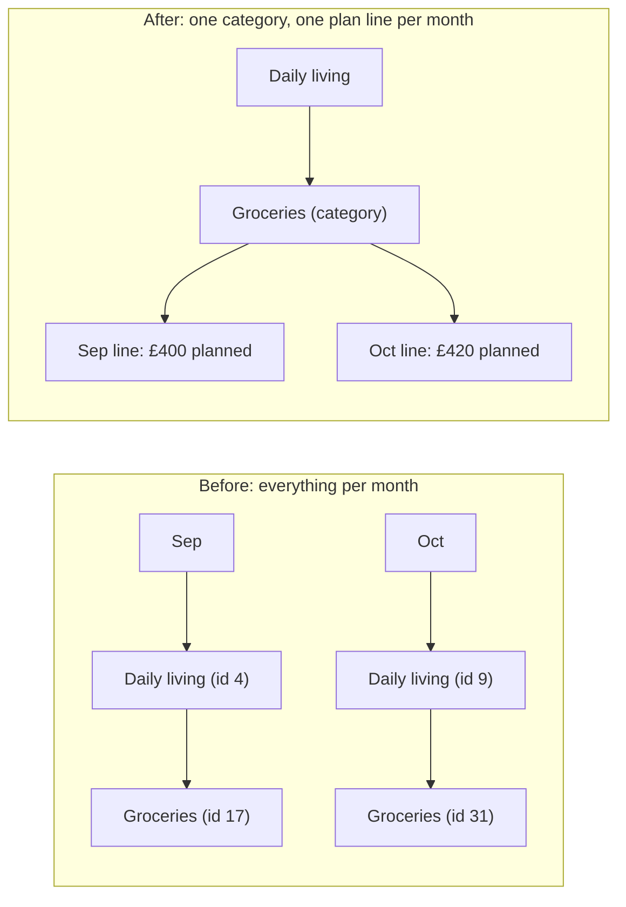
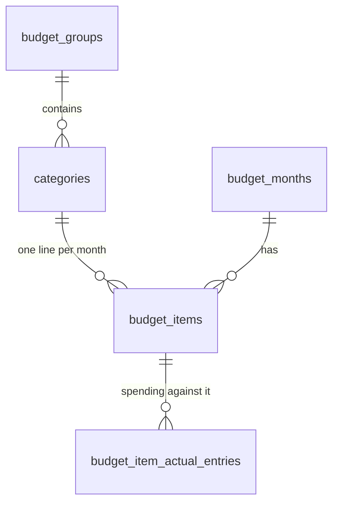
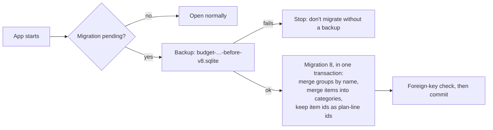

# PR 32 overview: month-independent categories

**Related:** feature [categories](../features/categories_feature.md) and [upload transactions](../features/upload-transactions_feature.md) · needed by [#33 upload transactions](pr33-upload-transactions_overview.md) · [spec](../specs/pr32-categories_spec.md) · [decisions](../key-decisions/pr32-categories_decisions.md) · [PR #32](https://github.com/JoseSilva1997/zero-based-budget-app/pull/32)

## Context

Starting a new month **cloned** the previous month's groups and items with **new IDs**, so nothing in the database said that September's "Groceries" and October's "Groceries" were the same thing. Renames had to be repeated month by month, and duplicates couldn't be cleaned up across history. It also blocked the next feature, uploading bank statements ([#33](pr33-upload-transactions_overview.md)): its classifier learns "this shop → this category", which only works if a category means the same thing in every month.

## What it does

It gives each budget line a **category that is the same in every month**. "Groceries" in September and October is now one category with one plan line per month, instead of two unrelated rows.

For the user:
- Renaming or moving a line renames or moves it in every month.
- **Settings → Categories** lists every category. You can archive old ones and **merge** duplicates; the app shows the impact first and backs up before writing.

## How it works

### Before and after

### Data model

- **`budget_groups`**: shared by all months (Daily living, Bills…).
- **`categories`** (new): the stable thing ("Groceries"), belonging to a group.
- **`budget_items`**: a **plan line**, i.e. one category's planned amount in one month. Unique per (month, category).
- **`budget_item_actual_entries`**: unchanged. Each entry still belongs to a plan line, so its month and category are both one join away.

### The rules in short

| You do | What happens |
|---|---|
| Rename or move a line | The category changes in **every** month |
| Add a line by a name that already exists | The existing category is reused, not duplicated |
| Delete a line from a month | Only that month's line goes; the category is deleted once nothing uses it |
| Archive a category | Hidden from pickers and new months; history kept |
| Merge A into B | A's lines and entries move to B; same-month lines are summed; A is deleted |
| Start a new month | Copies the plan lines of non-archived categories |

Groups follow the same pattern. Every active group shows in every month, names are reused rather than duplicated, and a group removed from a month is archived if other months still use it.

### Upgrading existing data

Because each old item keeps its id as the new plan line's id, every entry stays attached without being rewritten.

## Where the code lives

| Area | Files |
|---|---|
| Schema and migration | `database/schema.sql`, `database/migrations.ts` (migration 8), `database/triggers.sql` |
| Backup before migrating | `main/db.ts`, `database/repositories/backups.ts` |
| Category rules (rename, prune, archive, merge) | `database/repositories/categories.ts` |
| Month reads and writes (lines, groups, copy) | `database/repositories/months.ts` |
| IPC (main ↔ renderer) | `main/ipc/categories.ts`, `main/ipc/groups.ts`, `main/ipc/items.ts`, `preload/index.ts` |
| UI | `renderer/Settings.jsx` (Categories section), `renderer/MonthGroups.jsx` (hints), `renderer/store.jsx` (cache refresh) |
| Types | `shared/types.ts` |

## How to try and test it

- **Run the app:** `npm start`. Open Settings → Categories, archive something, then merge two categories. On Month Budget, rename a line and check an older month.
- **Run the tests:** `npm test`. The relevant suites are `migration-electron`, `categories-electron`, `settings-categories-electron` and `store-months-electron`.

## Limits and what's parked

- Groups can't be merged; a rename into an existing group name is refused instead.
- A category's name and group can't differ between months.
- A merge can only be undone by restoring the backup it takes.
