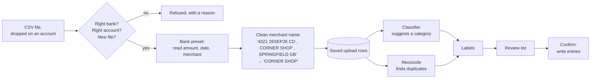
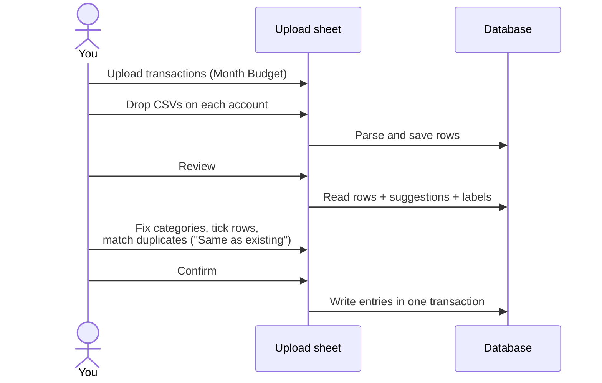
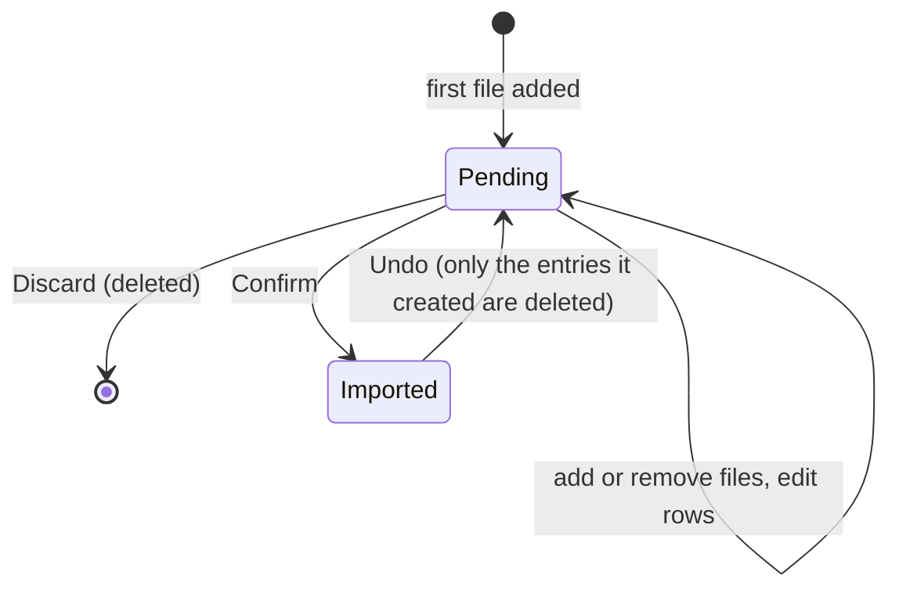

# PR 33 overview: upload transactions from bank statements

**Related:** feature [upload transactions](../features/upload-transactions_feature.md) · builds on [#32 categories](pr32-categories_overview.md) · [spec](../specs/pr33-upload-transactions_spec.md) · [decisions](../key-decisions/pr33-upload-transactions_decisions.md) · [PR #33](https://github.com/JoseSilva1997/zero-based-budget-app/pull/33)

## Context

Every actual entry was typed by hand. A month of spending across several bank accounts meant dozens of entries, each a chance for a typo or a missed transaction. The banks already hold that data and export it as CSV. The Engineer wanted the app to read those exports without giving up control: every row is still seen and approved before it reaches the budget.

## What it does

You can now **upload the bank-statement CSVs** you download from your bank. The app reads every transaction, suggests a category for each, flags anything suspicious, and shows it all in a review list. You fix what's wrong and press **Confirm** once.

Supported banks: **Monzo, Lloyds, Revolut, NatWest**.

## How it works

### The pipeline

1. **Refusals:** files from the wrong bank, statements for a different account, or a file already added are rejected straight away. The first time you upload for an account, the app asks which bank it's with.
2. **Bank preset:** each bank's CSV looks different, so a small built-in adapter per bank turns it into the same row shape. Each row gets a date, an amount in pence, debit or credit, and a cleaned merchant name.
3. **Classifier:** suggests a category by comparing the merchant name with transactions you've confirmed before ("CORNER SHOP" was Groceries last time). It runs locally; nothing leaves your machine. It starts empty and learns from every confirm.
4. **Reconcile:** looks for entries you already typed with the same amount within 3 days ("Possible duplicate"), and for transactions already imported from an earlier statement ("Already imported").
5. **Labels:** each row gets labels that set its default, ticked or not:

| Colour | Labels | Effect |
|---|---|---|
| none | — | Clean row, ticked |
| amber | No category, Check category, Not in this month's plan, Possible duplicate, Outside this month | Starts unticked; you decide |
| neutral | Transfer | Money moving between your own accounts; unticked |
| red | Money in, Already imported, Couldn't read, Not completed | Can't be imported |

### Using it

- **Same as existing:** says that a bank row and an entry you already typed are the same spend. No new entry is created, your entry stays as you typed it, and the classifier learns from the pair. Uploading old statements into months you entered by hand teaches the classifier quickly.
- **Over plan after import:** before you confirm, the footer shows which categories this upload pushes over plan. That also exposes a row in the wrong category.

### An upload's life

Each month has at most one pending upload, and it's saved: close the app and it's still there.

## Where the code lives

| Area | Files |
|---|---|
| Schema (migration 9) | `database/schema.sql`, `database/migrations.ts` |
| Reading CSVs and bank presets | `main/import/csv.ts`, `main/import/presets/*.ts`, `main/import/clean.ts` |
| Fingerprint, classifier, labels | `main/import/fingerprint.ts`, `main/import/classifier.ts`, `main/import/labels.ts`, `main/import/pipeline.ts` |
| Saved uploads (add, review, confirm, undo) | `database/repositories/imports.ts`, `database/repositories/banks.ts` |
| IPC contract | `main/ipc/imports.ts` (documented in its header), `preload/index.ts` |
| UI | `renderer/Upload.jsx`, `renderer/lib/imports.js`, `renderer/styles/upload.css`, `renderer/ui/overlays.jsx` (shared `Sheet`) |
| Design rules | `DESIGN.md`: The Label Chip Exception, Lantern Amber |

## How to try and test it

- **Run the app:** `npm start`. Open Month Budget, then **Upload transactions**, and drop a CSV from `tests/fixtures/import/` on an account. Its data is invented.
- **Run the tests:** `npm test`. The relevant suites are `import-parse-electron`, `banks-electron`, `import-engine-electron`, `import-repo-electron` and `upload-sheet-electron`.
- **Real statements:** keep them in `bank_statements/`, which is gitignored. Never commit them or copy them into fixtures.

## Limits and what's parked

- **Formats:** CSV only, and only the four banks above. Another bank needs a new preset.
- **Matching:** duplicates need the exact same amount, within 3 days. An entry typed with a different amount or date, or one entry covering two bank rows, isn't found. "Same as existing" only offers the candidates found, so such rows can't be matched yet.
- **Refunds and credits:** never become entries.
- **Splitting:** one row can't be split across categories.
- **Thresholds:** the classifier's (0.6 / 0.3) are untuned starting values.
