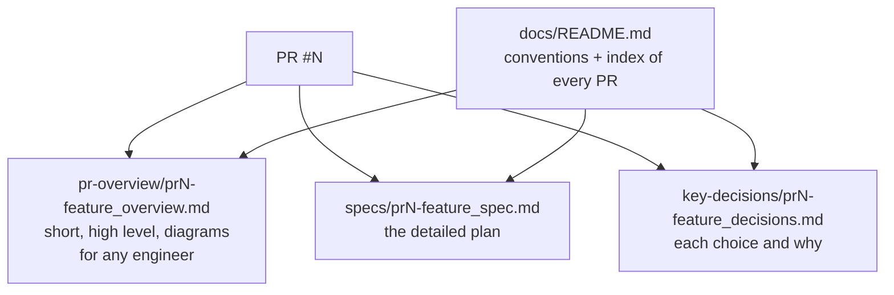

# PR 34 overview: docs structure

**Related:** backfills docs for [#32](pr32-categories_overview.md) and [#33](pr33-upload-transactions_overview.md) · [PR #34](https://github.com/JoseSilva1997/zero-based-budget-app/pull/34)

## What it does

It starts tracking `docs/` in git and sets one convention for documenting pull requests. Each substantial PR leaves three files behind, named by its PR number:

It also backfills those files for #32 (categories) and #33 (upload transactions).

## Why

Design reasoning used to live only in conversations and PR descriptions on GitHub; `docs/` was gitignored. Now it sits next to the code, findable by PR number, and readable by someone new to the project.

## How it works

- **Workflow:** open a draft PR, write the spec as its first commit, build, then record decisions and write the overview before merging. Add a row to the index in `docs/README.md`.
- **When:** feature PRs and non-trivial fixes get all three files; small fixes get an overview only. Dependabot PRs, release PRs and trivial changes get none.
- **Snapshots:** files describe the PR as it merged. Later PRs link back instead of rewriting them.
- **Diagrams:** Mermaid, so GitHub renders them and they diff like text.
- **Privacy:** the repo is public, so docs, fixtures and tests use invented data only.

## Where it lives

| File | Purpose |
|---|---|
| `docs/README.md` | The conventions, templates and index |
| `docs/specs/`, `docs/key-decisions/`, `docs/pr-overview/` | The files |
| `CLAUDE.md` → "Docs" | Points agents at the conventions and the privacy rule |
| `README.md` → "Contributing" | Points people at `docs/` |
| `.gitignore` | Stops ignoring `docs/`, and ignores `bank_statements/` (real statements, kept local) |

## Limits

- Nothing enforces the convention yet: no CI check. If PRs start slipping through, add a check that fails a PR into `staging` with no overview for its number.
- PRs before #32 have no docs. Their reasoning was never written down, so it isn't backfilled.
