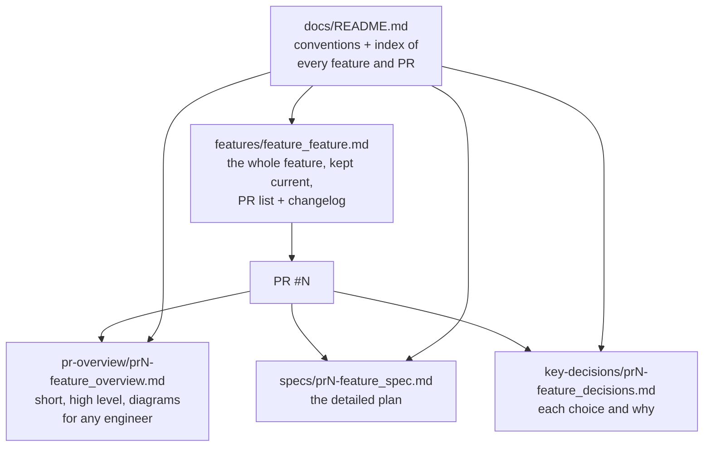

# PR 34 overview: docs structure

**Related:** backfills docs for [#32](pr32-categories_overview.md) and [#33](pr33-upload-transactions_overview.md) · [PR #34](https://github.com/JoseSilva1997/zero-based-budget-app/pull/34)

## Context

Design reasoning lived only in conversations and in PR descriptions on GitHub, and `docs/` was gitignored. The Engineer wanted each change documented next to the code: findable by PR number, and readable by an engineer new to the codebase. A feature built over several PRs should also have one place that explains it as a whole.

## What it does

It starts tracking `docs/` in git and sets one convention. Each substantial PR leaves three snapshot files behind, named by its PR number. Each feature has one living doc that links all of its PRs and keeps a changelog:

It also backfills the files for #32 (categories) and #33 (upload transactions), and adds the two feature docs.

It also adds two user-invoked skills that run this workflow end to end: `/feature-workflow` stops for the Engineer after every slice and PR, and `/feature-workflow-afk` settles open questions itself and stops only before outward steps (push, PR edits). Both follow one shared workflow file, which writes these docs as part of every PR.

## How it works

- **Workflow:**
  1. Open a draft PR, with the spec's original plan as its first commit.
  2. Build.
  3. Before merging: update the spec to describe what was built (keeping the original plan), record the decisions, write the overview, and update the feature doc and its changelog.
  4. Add rows to the index in `docs/README.md`.
- **When:** feature PRs and non-trivial fixes get all three files; small fixes get an overview only. Dependabot PRs, release PRs and trivial changes get none.
- **Snapshots and living docs:** PR files describe the PR as it merged and are never rewritten. Feature docs are the living layer, updated by every PR that changes the feature.
- **Roles:** "Engineer" for the person; agents by role with an "Agent" suffix (Planner Agent, Coding Agent, Reviewer Agent).
- **Diagrams:** Mermaid, so GitHub renders them and they diff like text.
- **Privacy:** the repo is public, so docs, fixtures and tests use invented data only.

## Where it lives

| File | Purpose |
|---|---|
| `docs/README.md` | The conventions, templates and index |
| `docs/features/` | One living doc per feature |
| `docs/specs/`, `docs/key-decisions/`, `docs/pr-overview/` | The per-PR files |
| `CLAUDE.md` → "Docs" | Points agents at the conventions and the privacy rule |
| `README.md` → "Contributing" | Points people at `docs/` |
| `.claude/skills/feature-workflow/`, `.claude/skills/feature-workflow-afk/` | The two skills: they set only which gates stop |
| `.claude/workflows/feature-workflow.md`, `feature-workflow-briefs.md` | The shared workflow and the Coding and Reviewer Agent brief templates |
| `.gitignore` | Stops ignoring `docs/`, and ignores `bank_statements/` (real statements, kept local) |

## Limits

- Nothing enforces the convention yet: no CI check. If PRs start slipping through, add a check that fails a PR into `staging` with no overview for its number.
- PRs before #32 have no docs. Their reasoning was never written down, so it isn't backfilled.
