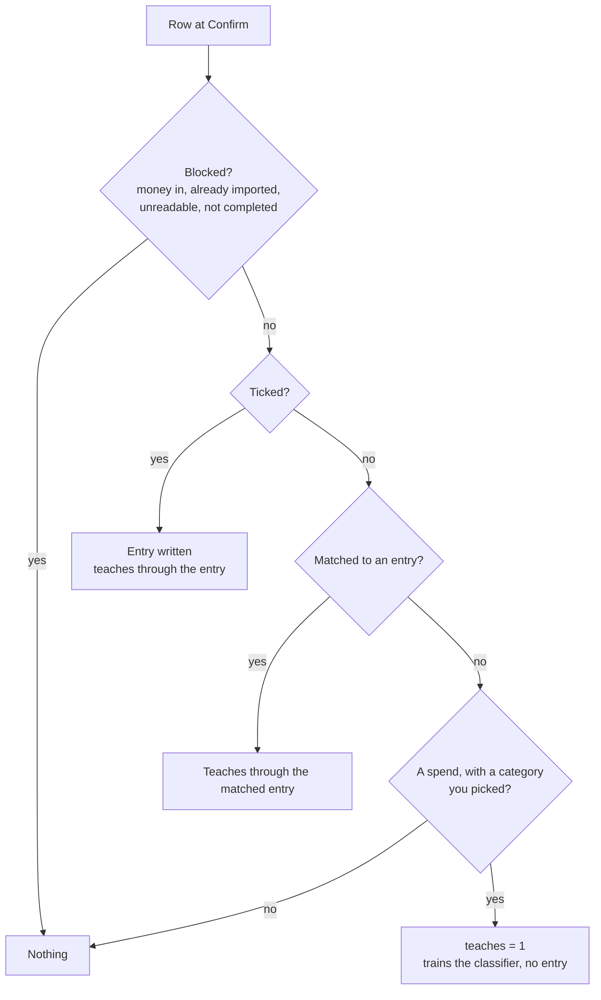

# PR 37 overview: upload review improvements

**Related:** feature [upload transactions](../features/upload-transactions_feature.md) · builds on [#33 upload transactions](pr33-upload-transactions_overview.md) · [decisions](../key-decisions/pr37-upload-review_decisions.md) · [PR #37](https://github.com/JoseSilva1997/zero-based-budget-app/pull/37)

## Context

After using uploads on real statements, the Engineer hit three gaps in the review:

- **No way to classify without importing.** Some rows should not become entries, but their payee is worth teaching the classifier. Unticking a row threw that choice away.
- **No notes.** An entry typed by hand can carry a note; an imported one couldn't, so "whose ticket was this?" had nowhere to go.
- **A Lloyds statement was refused.** One month's export ended its header line in a comma, and the app said it didn't look like a Lloyds statement.

There was no spec: the changes were small and decided one at a time, in conversation.

## What it does

- **Teach without importing.** Pick a category for a row and leave it unticked. Confirm writes no entry for it, but the classifier learns that category. The footer counts these ("3 to learn from"), and Confirm works even when they are all there is; the toast then says "Learnt 3 categories."
- **Notes.** The pencil in a row's actions opens a note under the row. Confirm writes it onto the entry. Rows that write no entry of their own (matched, transfers, blocked) take none.
- **Headers ending in a comma** are read like any other, for every bank.

## How it works

### Which rows teach

- `assessRow` (`main/import/labels.ts`) works out a `teaches` flag with the rest of a row's assessment, and the review sends it, so the footer only counts flags and never repeats the rule.
- A category the classifier guessed never teaches: it would only be learning from itself.
- Confirm saves the flag on the row (`import_rows.teaches`), because whether a row was blocked, or predicted to be a transfer, depends on the database at that moment. The classifier gains a third training source: rows with `teaches = 1` in an imported batch, labelled with their category unless it is archived. Undo clears the flag, so an undone import takes its lessons back.

### Notes

A note is stored on the upload row (`import_rows.note`, trimmed, blank is none) until Confirm writes it as the entry's `note`.

### Migrations

| Version | Adds | Why its own |
|---|---|---|
| 10 | `import_rows.teaches` | |
| 11 | `import_rows.note` | A development build of this branch ran 10 on a real database before `note` existed, and a version runs only once. |

## Where the code lives

| Area | Files |
|---|---|
| Which rows teach | `main/import/labels.ts` |
| Training, confirm, undo, notes | `database/repositories/imports.ts` |
| Columns | `database/schema.sql`, `database/migrations.ts` (10, 11) |
| Header with a trailing comma | `main/import/csv.ts` |
| Footer count, toast, note line | `renderer/Upload.jsx`, `renderer/lib/imports.js`, `renderer/styles/upload.css` |

## How to try it and test it

- Upload a statement, pick a category for a row and untick it. The footer says "1 to learn from"; Confirm; upload another statement with the same payee into another month and it is predicted.
- Open a row's note with the pencil, write one, Confirm: the entry carries it.
- Tests: `tests/import-engine-electron.cjs` (the `teaches` rule), `tests/import-repo-electron.cjs` (teach-only confirm, what is learnt, archived, undo, notes), `tests/upload-sheet-electron.cjs` (footer, toast, note line), `tests/import-parse-electron.cjs` (trailing comma), `tests/migration-electron.cjs` (a v10 database without `note`).

## Limits and what's parked

- **Re-uploads.** A taught row isn't treated as already imported, so re-uploading the same statement may predict and tick it again. The Engineer accepted this: re-uploads are rare.
- **Notes on matched rows.** Not offered; the matched entry keeps its own note.
- **Shared accounts.** A payee used for different purposes on a joint and a personal account needs no code: a joint-only category works, because the classifier weighs the account. With only one joint example among several personal ones, the first guesses land in "Check category" until a few more are confirmed.
