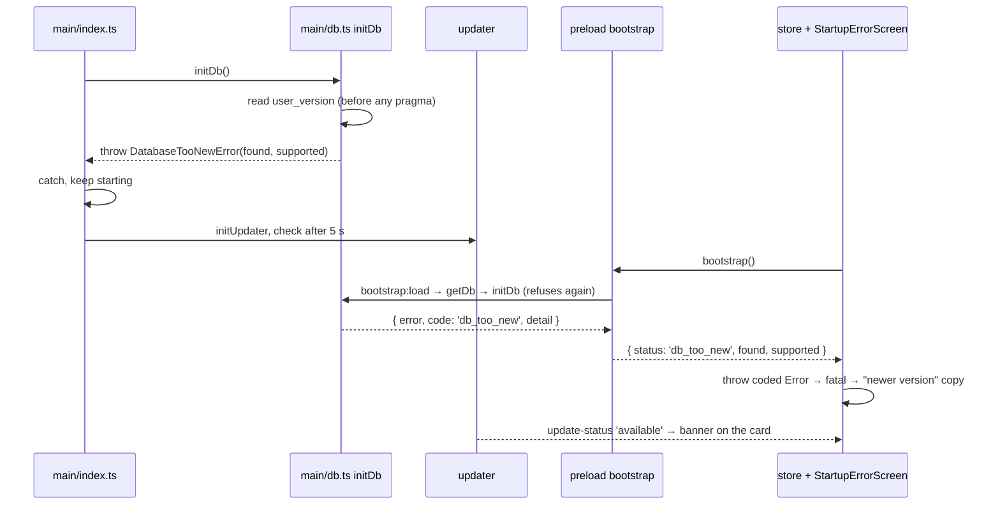

# PR 42 overview: a database from a newer version

**Related:** [spec](../specs/pr42-newer-database_spec.md) · [decisions](../key-decisions/pr42-newer-database_decisions.md) · [PR #42](https://github.com/JoseSilva1997/zero-based-budget-app/pull/42)

## Context

A development build migrated a real database to schema version 10. The installed release, which knows schema 7, then failed on its first query (`no such column: budget_month_id`) and showed the startup error screen's only message: the app is probably open in another window, or a sync program has the file. Neither was true, and the data was fine. `initDb` had noticed the version was too high, but only logged a warning and carried on.

Releases reach users through the auto-updater, so an older install opening a newer database will happen again: after restoring a backup made on an updated machine, or with two machines sharing a synced folder.

## What it does

When the budget file was saved by a newer version, House Budget now stops before touching it and says so:

> **This budget is from a newer version**
> This budget was saved by a newer version of House Budget. Update the app to open it. Your budget file is still on this device, and nothing has been changed.
> `Budget file: version 10. This version of House Budget reads up to version 7.`

Once the updater finds a release (about five seconds after start), the update banner appears on the same card, so updating is one click. Every other startup failure keeps the existing message.

## How it works

The version is the only thing read from the file. `journal_mode = WAL` would rewrite its header, so the check comes before the connection pragmas, migrations and the pre-migration backup. Quitting skips the backup-on-close step when the database never opened, so an update's restart from this state works.

## Where the code lives

- `main/db.ts`: `DatabaseTooNewError`, the check in `initDb`, `isDbOpen`.
- `main/index.ts`: startup carries on past the refusal; `before-quit` handles an unopened database.
- `preload/index.ts`, `shared/types.ts`: `bootstrap` returns `DbTooNew` instead of throwing.
- `renderer/store.jsx`: turns that into a coded fatal error.
- `renderer/StartupError.jsx`: the startup error screen, moved out of `main.jsx`, with the two cases.
- `tests/newer-database-electron.cjs`: the test.

## How to try it and test it

`npm test` runs `tests/newer-database-electron.cjs`. It opens a file database with `user_version` above `LATEST_VERSION` through the real `initDb` and checks the error, the versions, and that the file was not changed (no WAL, no backup, same tables). It then mounts the store and the screen against a fake API and checks both sets of copy and the banner.

By hand, never on your real data: point a dev build at a scratch `userData` folder, let it create a test database, quit, run `PRAGMA user_version = 99` on that file, and start it again.

## Limits and what's parked

- If no update is found (offline, a staging build, or a database from an unreleased development build), the card says to update but shows no banner. The application menu's "Check for updates" still runs, but its toast has nowhere to show on this screen.
- Restoring a newer version's backup from Settings is not covered: the backup check doesn't look at the version yet.
