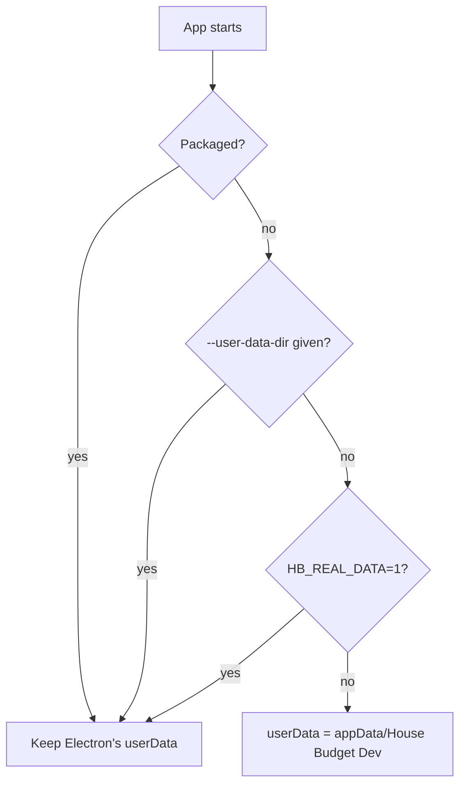

# PR 43 overview: dev data folder

**Related:** no feature doc (a development safeguard, not a user feature) · [PR #43](https://github.com/JoseSilva1997/zero-based-budget-app/pull/43)

## Context

`npm start` and `npm run dev` ran under the same app name as the installed release, so they opened its data folder. Trying a branch with a newer schema migrated the real database (it was backed up first), and the installed release then refused to open it with `no such column`. Staging builds already avoid this with their own app name; development launches had no such guard.

## What it does

Any launch where Electron is not packaged now keeps its data in its own folder, **House Budget Dev**, beside the installed app's. Setting `HB_REAL_DATA=1` opens the real data on purpose. Packaged builds (release and staging) are unchanged.

## How it works

`main/index.ts` calls `isolateDevUserData()` before anything reads userData. The decision is a pure function, `devUserDataPath`, so it is tested without touching any real folder.

An explicit `--user-data-dir` wins so the screenshot skill keeps its sandbox. The test suite sets its own userData path and never loads `index.ts`, so it is unaffected.

## Where the code lives

- `main/devUserData.ts`: the decision and the `app.setPath` call.
- `main/index.ts`: calls it at startup.
- `tests/dev-userdata-electron.cjs`: the decision's cases.
- `README.md`, "Development data folder": folder locations and the escape hatch.

## How to try it and test it

- `npm test` runs `tests/dev-userdata-electron.cjs` with the rest.
- `npm start`: the console prints `[house-budget] userData: …/House Budget Dev`.
- `HB_REAL_DATA=1 npm start`: prints the installed app's folder, with a warning.

## Limits and what's parked

- The dev folder starts empty. Copy a backup in, or restore one from Settings, to work against realistic data.
- Only `userData` moves; the app name and window title are unchanged.
