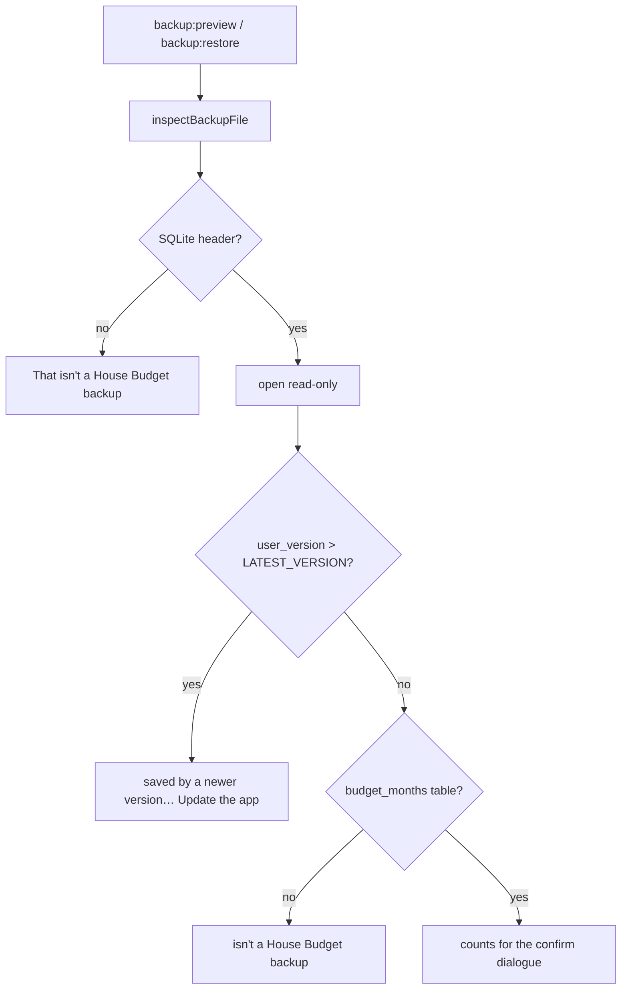

# PR 44 overview: restoring a backup from a newer version

**Related:** earlier: [PR #42 overview](pr42-newer-database_overview.md) (the startup refusal this completes) · [PR #44](https://github.com/JoseSilva1997/zero-based-budget-app/pull/44)

## Context

PR #42 made startup refuse a database saved by a newer version of House Budget and explain it. It left one way in: restoring a backup from Settings. `inspectBackupFile`, which checks a file before anything is overwritten, never looked at the schema version. A newer version's backup then went one of two ways:

- If its schema had changed in a way the backup checks trip over, the counts query failed and the user was told "That backup file is damaged and can't be read." The file was fine.
- Otherwise it was restored over the live database, and the reopen after the restore hit #42's refusal. The running app was left with no database until restart.

## What it does

Picking a backup saved by a newer version now stops at the preview, before anything is copied:

> That backup was saved by a newer version of House Budget. Update the app to restore it.

The live database is not touched. Backups from this version or older restore as before.

## How it works

The version check is the first thing run on the read-only connection, before any table is queried, so a schema this build doesn't know can't turn into a "damaged" message. `restoreFromFile` re-runs `inspectBackupFile` before copying, so the refusal also holds if the renderer skips the preview.

## Where the code lives

- `database/repositories/backups.ts`: the check in `inspectBackupFile`, reusing `getUserVersion` and `LATEST_VERSION` from `database/migrations.ts`.
- `tests/backup-electron.cjs`: `newerBackupChecks`.

## How to try it and test it

`npm test` runs `tests/backup-electron.cjs`. It builds two test backups with `user_version` above `LATEST_VERSION`: one otherwise current (which used to restore) and one with a renamed table (which used to be called damaged). Both must be refused with the new message, `restoreFromFile` must refuse and leave the live file byte-for-byte unchanged, and a current-version backup must still pass.

By hand, never on your real data: in a dev build pointed at a scratch `userData` folder, save a backup, run `PRAGMA user_version = 99` on the backup file, and pick it under Settings → Restore.

## Limits and what's parked

- The message doesn't show the update banner the startup screen does; the app is running, so the normal update banner and the menu's "Check for updates" already cover it.
- A cloud-folder backup is checked the same way, after it is staged locally.
