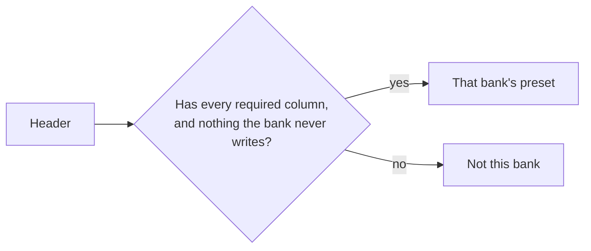

# PR 47 overview: Lloyds exports with chosen columns, and Monzo's shorter export

**Related:** feature [upload transactions](../features/upload-transactions_feature.md) · follows [#37 upload review](pr37-upload-review_overview.md) · [PR #47](https://github.com/JoseSilva1997/zero-based-budget-app/pull/47)

## Context

Two real statements were refused as "doesn't look like a ... statement":

- a **Lloyds** export with only five of its eight columns (Lloyds lets you choose them): no sort code, account number or balance;
- a **Monzo** export in a shorter format (`ID, Created, Title, Subtitle, Amount, Currency, Categories`) than the one the preset knew.

Presets recognised a bank by its exact header, so any other column set was refused.

## What it does

Both statements upload. A Lloyds export without its account columns isn't checked against the account, since it doesn't say which one it is.

## How it works

- `hasColumns(header, required, optional)` in `main/import/presets/common.ts`. Lloyds requires date, description, debit and credit; type, sort code, account number and balance are optional.
- Monzo accepts its full export exactly, or the shorter one (ID, Created, Title and Amount required). The shorter one has no transaction type, so a **pot move** is recognised as two rows with the same title, opposite amounts and the same `Created` minute, and the pair is dropped. Each row pairs once. `Created` ("28/10/26, 09:08") is read by `dmyShortToIso`.

| Rows in the shorter Monzo export | Kept? |
|---|---|
| Card payment, payment to a person | Yes |
| Pot move: same title, ±amount, same minute | No, the pair is dropped |
| Round-up into a pot (one row, money in) | Kept, as "Money in", so it can't be ticked |

## Where the code lives

`main/import/presets/common.ts`, `lloyds.ts`, `monzo.ts`.

## How to try it and test it

- Upload a Lloyds export with only some columns, and a Monzo export in the shorter format.
- Tests: `tests/import-parse-electron.cjs`, with invented fixtures `tests/fixtures/import/lloyds-short.csv` and `monzo-short.csv`.

## Limits and what's parked

- A pot move whose two halves land in different minutes isn't paired, and shows as two rows; mark them Transfer.
- Monzo's shorter export names no account, like its full one.
