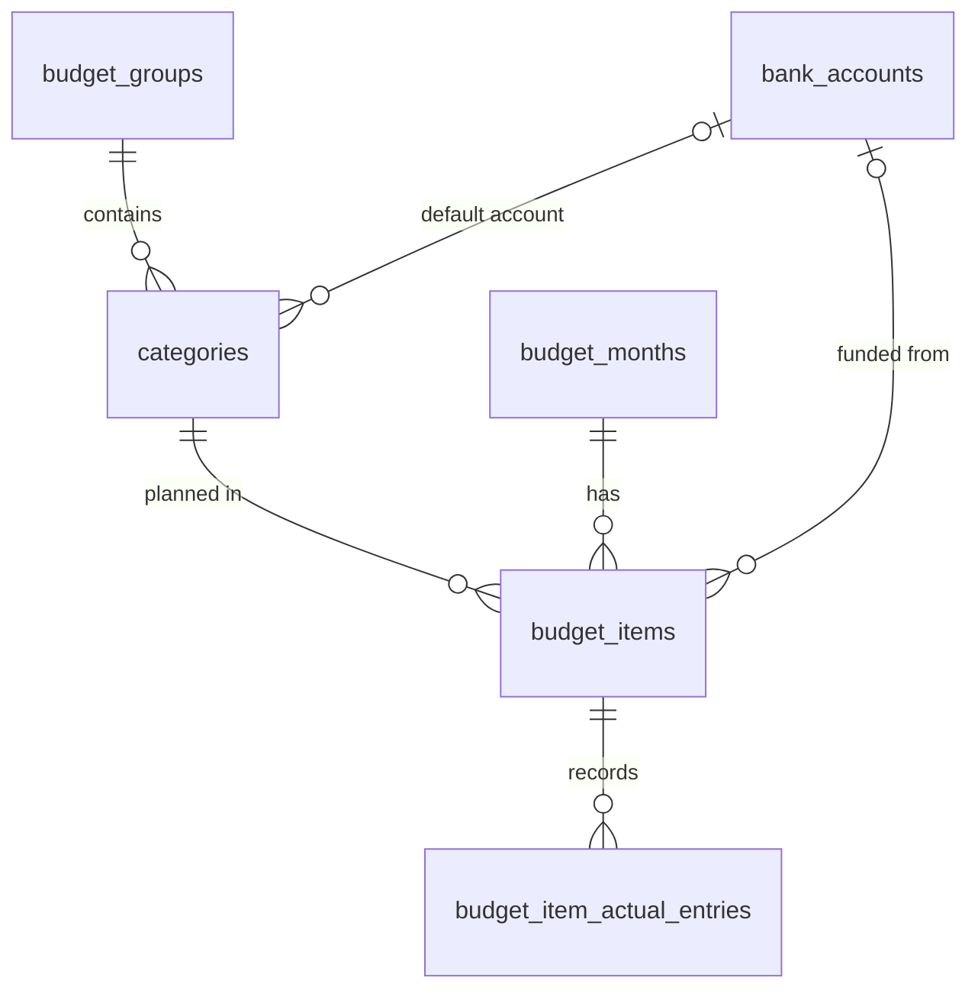

# PR 32 spec: month-independent categories

**Related:** feature [categories](../features/categories_feature.md) · needed by [#33 upload transactions](pr33-upload-transactions_spec.md) · [overview](../pr-overview/pr32-categories_overview.md) · [decisions](../key-decisions/pr32-categories_decisions.md)

Sections 1–7 describe what was built. Section 8 lists what changed from the plan, and section 9 keeps the original plan, agreed on 2026-10-18, unedited.

## 1. Goal

Give every budget category one identity that lasts across months. Until now, starting a month cloned that month's groups and items with **new IDs**, so the app had no link between "Groceries" in September and "Groceries" in October. Uploading bank statements (#33) needs that link: its classifier predicts a category, and the prediction must mean the same thing in every month.

## 2. Scope and non-goals

**In scope**
- Schema: global groups, a new `categories` table, and items turned into per-month plan lines.
- Migration 8, which converts existing databases, preceded by a backup.
- Rename, move, delete and archive behaviour under the new model.
- Settings → Categories: list, archive and unarchive, and merge (with a preview of its impact).
- Hints on the month screen that a rename or move applies to every month.

**Non-goals**
- Merging groups.
- Per-month overrides of a category's name or group.
- Any part of the upload feature (#33).

## 3. Data model

| Table | Change | Columns |
|---|---|---|
| `budget_groups` | Now global: `budget_month_id` removed | `id`, `name`, `kind` (`spend`/`savings`/`debt`), `collapsed`, `archived`, `sort_order`, timestamps |
| `categories` | New | `id`, `group_id` (FK, RESTRICT), `name`, `bank_account_id` (default account for new lines), `archived`, `sort_order`, timestamps. Unique index on `(group_id, name COLLATE NOCASE)`, backing up a normalised-name check in code. |
| `budget_items` | Now a month's **plan line** | `id`, `budget_month_id` (FK, CASCADE), `category_id` (FK, RESTRICT), `planned_cents`, `bank_account_id` (per month, because transfer planning is per month), `sort_order`, timestamps. `UNIQUE(budget_month_id, category_id)`. No `name` and no `budget_group_id`: both come from the category. |
| `budget_item_actual_entries` | Unchanged | Still points at `budget_item_id`; the category is one join away. |

Every table keeps an `updated_at` trigger, and `categories` gains one.

**Names are compared normalised:** trimmed, internal whitespace collapsed, case-insensitive (`normalizeName` in `database/repositories/categories.ts`).

## 4. Behaviour rules

### Categories
- **Rename** an item = rename its category, in **every month**, past ones included. A name already used by another category in the same group is refused, pointing to merging in Settings.
- **Move** an item to another group = move its category in every month. In other months its lines go to the end of the new group.
- **Add an item by name:** reuse the category in that group with that normalised name (un-archiving it and its group), otherwise create one. If the category already has a line in this month, refuse.
- **Delete an item from a month:** delete that plan line, with its entries, as before. If the category then has no lines and no entries anywhere, delete it.
- **Archive** (Settings only): hidden from pickers and from newly created months. Its history stays.
- **Changing a line's account** also sets the category's default account, so the next new line starts on the last account chosen.

### Groups
These rules (A–G) were settled during the build.
- **A. Visibility:** a month shows every non-archived group, plus any archived group that has a line in that month. A new, empty month therefore shows all active groups.
- **B. Add a group by name:** reuse the group with that normalised name (un-archiving it). Otherwise create one.
- **C. Rename a group** to a name another group already uses: refused.
- **D. Delete a group from a month:** delete that month's lines in it, pruning categories as above. Then delete the group if it has no categories left, otherwise archive it.
- **E. Emptied group:** a group whose last category is pruned, moved out or merged away is deleted.
- **F. Migration:** a group missing from the newest month that has groups is archived.
- **G. Hints:** the drag handle, Move button, move menu and item-name tooltip say the change applies in every month.

Rename, kind, collapse and reorder of groups apply globally.

### Copying a month
`copyMonth` copies plan lines (`category_id`, `planned_cents`, `bank_account_id`, `sort_order`) of **non-archived categories** only. Income copying is unchanged.

### Merge category A into B
- Every plan line and entry moves from A to B.
- When A and B both have a line in the same month, the two lines become one: planned amounts are summed and entries moved to B's line.
- A is deleted. B keeps its name, group, default account and archived flag.
- `previewMerge` returns the impact `{entries, months}` without writing. Both go through one check, `assertMergeable`, which refuses merging a category into itself.
- The IPC handler takes a backup (`backupNow`) before merging, and the result names the backup file.

### Migration 8
- **Backup:** `runMigrations` takes a `beforeMigrating` hook, and `main/db.ts` uses it to write `budget-<ts>-before-v8.sqlite` (via `VACUUM INTO`) before any pending migration. A fresh install skips the backup. If the backup fails, startup stops.
- **One transaction:** the migration is `atomic: false` with foreign keys off, does all its work in one transaction, and runs `foreign_key_check` before committing. It does nothing if `budget_groups.budget_month_id` is already gone.
- **Groups:** merged on normalised name. `kind`, `collapsed` and order come from the newest month that has the group.
- **Categories:** merged on normalised `(group name, item name)`. Name and order come from the newest month; the default account from the newest month's line.
- **Plan lines:** each old item becomes a plan line and **keeps its id**, so entries stay attached.
- **Same-month duplicates** (two same-named items in one group in one month): merged into one line, with planned amounts summed and entries moved.
- **Ordering:** by (newest month that has the row, then that month's `sort_order`), then renumbered, so values from different months don't tie.

## 5. UI

- **Settings → Categories** sits between Funding accounts and Data & backup.
  - Categories are grouped under their group, each with "N months · N entries".
  - Row actions **Merge…** and **Archive / Unarchive** appear on hover or focus.
  - Archived categories sit behind "Show archived (n)", one step down the ink ramp, with the word "Archived".
  - Merge is staged:
    1. Pick the target (any other category, in any group).
    2. **Review merge** shows a preview, e.g. "Moves 12 entries across 4 months into Groceries. Going Out is deleted.", and notes that a backup is taken and is the only undo.
    3. Confirm.
    4. A toast names the backup.
- **Month screen:** copy only. Tooltips and the move menu say "in every month".
- **Store:** after any edit, cached months other than the edited and active ones are dropped, because groups and categories are now shared.

## 6. Edge cases

- Same-named items in one group in the same month (migration).
- An old empty group that isn't in the newest month: archived, so it doesn't reappear in every month.
- A trailing empty month: "newest month" means the newest month that **has groups**.
- A rename that only changes case or spacing of its own name: allowed.
- Restoring a pre-v8 backup: it migrates on open, after its own backup.
- Deleting a bank account clears it from category defaults.

## 7. Test plan

- **`tests/migration-electron.cjs`**
  - A previous-version database with three months of realistic data: name variants, renamed groups, a newer kind and order, a same-month duplicate with entries, and empty groups.
  - Checks that no entries are lost and totals are preserved.
  - Checks that a fresh-install schema is identical to a migrated one.
- **`tests/categories-electron.cjs`**: every rule above, merge and its preview, archive, group rules A–G, and the IPC channels against a sandboxed database (including the backup before a merge).
- **`tests/settings-categories-electron.cjs`**: the Settings section in the real store with a fake bridge.
- **`tests/store-months-electron.cjs`**: dropping cached months after an edit.
- **Manual:** migration 8 run on a copy of a real database. Counts and totals unchanged, foreign-key and integrity checks clean.

## 8. Changes from the original plan

| Change | Why |
|---|---|
| **Group visibility and lifecycle rules A–G** added; groups gained an `archived` flag | The plan said only that groups are "stable across months". A Reviewer Agent found that an empty new month showed no groups, so adding "Bills" there created a duplicate group. The Planner Agent set the rules. |
| `budget_items` keeps a **per-month `bank_account_id`**; the category's account is only a default | Transfer planning (the Wallet) is per month, so moving the account onto the category would rewrite past months. |
| **Categories are pruned automatically** once nothing references them | The plan allowed deleting an unreferenced category but didn't say when. Pruning on the last line's deletion keeps lists clean. |
| **Backup before migrating** became a general hook (`beforeMigrating`), and startup stops if the backup fails | The plan required a backup; this makes it apply to every future migration, not just migration 8. |
| **Merge previews** (`previewMerge`) and a **backup before every merge** | The plan asked for a confirmation stating the impact; the preview computes it without writing. |
| **Cached months are dropped after an edit** | A Reviewer Agent found that cached months went stale once groups and categories were shared. |
| **Hints** that renames, moves and drags apply to every month | A Coding Agent noted the month screen gave no sign of it. |
| Adding a line **un-archives its category's group** | Keeps groups consistent with categories (rule B). |

## 9. Original plan

As agreed on 2026-10-18, before any code was written. Unedited.

> Items are cloned with new IDs every month, so nothing links "Groceries" in September to "Groceries" in October. The classifier needs that link as its label space, so the schema gets a real month-independent category.
>
> **Schema**
> - **`budget_groups`**: stable across months (they already are in practice).
> - **`categories`** (new): `group_id`, `name`, default `bank_account_id`, `archived`. This is what "Groceries" is, and what the classifier predicts.
> - **`budget_items`**: becomes a month's plan line: `(budget_month_id, category_id, planned_cents, sort_order)`, unique on `(budget_month_id, category_id)`.
> - **`budget_item_actual_entries`**: unchanged, still points at `budget_item_id`. The category is one join away.
> - **`copyMonth`**: copies plan lines only.
>
> **Behaviour**
> - Renaming a category, or moving it to another group, applies to every month, past ones included. If it is really a different thing, create a new category and archive the old one.
> - A category that any plan line or entry references can only be archived. Archived categories are hidden from pickers and from new months, but stay in history. Deleting outright is allowed only when nothing references it. Removing a line from one month deletes that plan line, not the category.
>
> **Migration**
> - Take a backup first, then run everything in one transaction.
> - Merge items across months on normalised `(group name, item name)`, and groups on their normalised name.
> - Names that only look different ("Food" and "Groceries") stay as two categories. The merge action fixes those.
>
> **Settings → Merge categories**
>
> Merging A into B:
> - Moves every plan line and entry from A to B.
> - When A and B both have a line in the same month, merges the two lines: the planned amounts are summed and the entries combined.
> - Deletes A.
> - Asks for confirmation with the impact, e.g. "Moves 143 entries across 9 months into Groceries".
> - Has no undo beyond the backup taken before the merge.
>
> **Scope**
>
> The code that touches groups and items: `database/schema.sql`, `triggers.sql`, `migrations.ts`, `repositories/months.ts`, `repositories/accounts.ts`, `main/ipc/{items,accounts,actuals}.ts`, `shared/types.ts`, `renderer/MonthGroups.jsx`, `renderer/store.jsx`, the electron tests and the screenshot seed fixture.
>
> Ships as its own PR into `staging`, with migration and repo tests.
