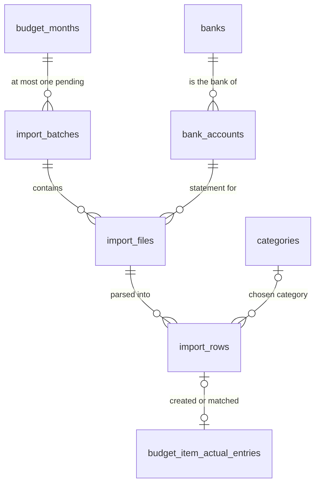
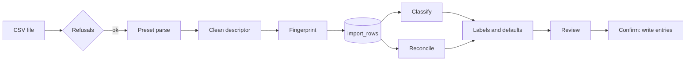

# PR 33 spec: upload transactions from bank statements

**Related:** feature [upload transactions](../features/upload-transactions_feature.md) · builds on [#32 categories](pr32-categories_spec.md) · [overview](../pr-overview/pr33-upload-transactions_overview.md) · [decisions](../key-decisions/pr33-upload-transactions_decisions.md)

Sections 1–7 describe what was built. Section 8 lists what changed from the plan, and section 9 keeps the original plan, agreed on 2026-10-18, unedited except that its examples were replaced with invented data. All examples use invented data.

## 1. Goal

Fill a month's actual entries from bank-statement CSV exports instead of typing each one. The user uploads statements, checks every row in a review list, and confirms once. Nothing reaches the budget without that review.

## 2. Scope and non-goals

**In scope**
- CSV files from **Monzo, Lloyds, Revolut and NatWest**, one built-in preset each.
- Debits only become entries. Other rows (credits and the like) are shown but blocked.
- A local classifier that suggests a category for each row.
- Duplicate detection against hand-typed entries and against earlier imports.
- A saved, resumable upload per month, with Undo after confirming.

**Non-goals (parked)**
- PDF statements.
- Refunds and credits as negative spend.
- Splitting one row across categories.
- A user-configurable column mapping.
- Pairing transfers automatically across accounts.
- Attributing joint-account spend to a member by card.

## 3. Data model (migration 9)

| Table | Columns |
|---|---|
| `banks` | `name` (unique, case-insensitive), `preset` (`monzo`/`lloyds`/`revolut`/`natwest`) |
| `bank_accounts` + | `bank_id` (FK, SET NULL), `account_identifier` (filled from the first file), `bank_product` (the Revolut `Product` this account maps to) |
| `import_batches` | `budget_month_id` (CASCADE), `status` (`pending`/`imported`/`discarded`), `created_at`, `imported_at`. A partial unique index allows at most one `pending` batch per month. |
| `import_files` | `batch_id` (CASCADE), `bank_account_id` (CASCADE), `filename`, `file_hash`. `UNIQUE(batch_id, file_hash)`. |
| `import_rows`: parsed | `file_id`, `row_index`, `raw` (JSON), `posted_on`, `spent_on`, `amount_cents` (≥ 0), `direction` (`debit`/`credit`), `descriptor_raw`, `descriptor_clean`, `features` (JSON), `parse_error`, `not_completed`, `fingerprint` (indexed) |
| `import_rows`: decisions | `category_id` (SET NULL), `name`, `kind` (`spend`/`transfer`, **NULL = use the prediction**), `included` (NULL = use the default), `linked_entry_id` (SET NULL) |
| `budget_item_actual_entries` + | `import_row_id` (FK, SET NULL) |

**Only the user's decisions are stored.** Predictions and labels are recomputed on every read, because they depend on database state that changes while an upload is pending. `mergeCategories` (#32) also moves `import_rows.category_id` to the target category.

## 4. Behaviour rules

### Pipeline

### Adding a file (`addFile`)
1. Get or create the month's pending batch.
2. Hash the file.
3. Run these refusals, before storing any rows:
   - **Same hash already in the batch:** "That file is already in this upload."
   - **The account has no bank:** a coded `needs_bank` refusal, carrying the detected preset (and, for Revolut, the products in the file). The UI shows an inline setup, then retries. The same refusal is used for a Revolut file holding several products when the account has none chosen.
   - **The header doesn't match the bank's preset:** "This doesn't look like a {bank} statement."
   - **The file's account number differs from the stored one** (Lloyds and NatWest only): "This is the statement for ••1234, not {account}." If none is stored yet, the file's number is stored. It's forgotten again if every file naming it is removed or discarded.
   - **No rows left for this account**, e.g. a file that only holds another Revolut product, or only Monzo pot transfers: "That file has no transactions in it."
4. Parse, clean, fingerprint and store the rows.

Removing a file deletes its rows, and is only allowed while the batch is pending.

### Presets

| | Monzo | Lloyds | Revolut | NatWest |
|---|---|---|---|---|
| Amount | Signed `Amount` | `Debit Amount` / `Credit Amount` | Signed `Amount`, net of `Fee`. A −8.74 debit with a 0.09 fee costs 883p. | Signed `Value` |
| `spent_on` | `Date` | `Transaction Date` | `Started Date` | The card date in the description (`26SEP26`), else `Date` |
| `posted_on` | same | same | `Completed Date`, else Started | `Date` |
| Descriptor | `Name` | `Transaction Description` | `Description` | The merchant segments of `Description` |
| Account number | — | `112233-12345678` (sort code + account) | — | `Account Number` |
| Dropped silently | `Pot transfer` rows | — | Other products' rows | — |
| Classifier features | `Category`, `Type` | `Transaction Type` | `Type` | `Type` |
| Other | — | — | Not `COMPLETED` → `not_completed` | — |

- **Amounts** are read from text straight into integer pence, never via floats. `.06` is read as 6p.
- **Header detection:** the same set of column names, ignoring order, case and padding.
- **A bad row** is kept, with `parse_error` naming the fields that failed.

### Descriptor cleaning
- **Generic, in order:**
  - trim and collapse whitespace
  - remove card fragments (`*1234`) and `*` separators
  - remove reference tokens (5+ digits, or a code of 8+ characters with 3+ digits), and cut one glued onto a name (`NAME41809`)
  - remove dates
  - remove a trailing store number
- **Casing is kept**, since the cleaned descriptor becomes the entry's default name. If cleaning would leave nothing, the trimmed original is kept.
- **Lloyds:** remove a trailing `#<digits>`.
- **NatWest:** `4321 26SEP26 CD , CORNER SHOP , PLC , SPRINGFIELD GB` → `CORNER SHOP PLC`.
  - Drop the card digits, the date and the marker (`CD`/`C`/`D`/none).
  - Drop foreign-currency and refund segments, and payment and transfer boilerplate.
  - The monthly charge becomes "Account charges".

### Fingerprint
A stable hash of `(bank_account_id, spent_on, amount_cents, direction, descriptor_raw, occurrence number among identical tuples in that file)`. It's the same rule for every bank. The occurrence number keeps two identical coffees on one day as two rows.

### Classifier
- **Model:** TF-IDF over word tokens of `descriptor_clean`, plus feature tokens (`type:`, `bankcat:`, `acct:`, an amount bucket). kNN by cosine, k = 5, with similarity-weighted votes.
- **Comparison:** only training rows that share at least one descriptor word are compared, so the extra signals break ties but can't make unrelated shops look alike.
- **Classes:** category ids, plus `transfer`.
- **Training examples**, from other batches only:
  - a row whose id is on an entry's `import_row_id`; its label is that entry's current category, read through the join so merges are followed. Archived categories are skipped.
  - a row the user marked `transfer` in an imported batch.
- **Confidence** = the winner's share of the vote × its best similarity.
  - At or above `HIGH_CONFIDENCE = 0.6`: a confident suggestion.
  - Between that and `LOW_CONFIDENCE = 0.3`: pre-filled, labelled `low_confidence`.
  - Below: no suggestion.
  - Both values are starting points, to be tuned.
- **Never saved:** rebuilt in memory on every review read.

### Reconcile
- **`possible_duplicate`** — an existing entry that:
  - has the same `amount_cents`
  - has a `spent_on` within ±3 days
  - is on a plan line whose account is the row's account, or has no account
  - isn't already imported or matched to another row

  The candidates are returned with the row.
- **`already_imported`:** the fingerprint matches a row in another batch that is in the budget (an entry's `import_row_id`, or a `linked_entry_id`). It also matches an earlier file in the **same** batch, which covers overlapping statements.

### Labels

| Label | Severity | Chip | Effect |
|---|---|---|---|
| `ok` | — | none | ticked |
| `uncategorised` | warn | "No category" | can't be ticked until a category is chosen; the row stays live |
| `low_confidence` | warn | "Check category" | unticked |
| `not_in_month` | warn | "Not in this month's plan" | unticked; confirm creates a £0 plan line |
| `possible_duplicate` | warn | "Possible duplicate" | unticked |
| `out_of_month` | warn | "Outside this month" | unticked; imports into the target month with its real date |
| `transfer` | info | "Transfer" | unticked; can be ticked by switching kind back to spend |
| `credit` | block | "Money in" | can't be ticked |
| `already_imported` | block | "Already imported" | can't be ticked |
| `parse_error` | block | "Couldn't read" | can't be ticked; the error is the tooltip |
| `not_completed` | block | "Not completed" | can't be ticked |

- **Block labels stand alone.** A row with a block label carries only that label, so it doesn't also collect noise labels.
- **Effective values:**
  - **Included:** the stored value, else ticked only when there's no warn, info or block label and there is a category.
  - **Category:** the stored one, else the prediction (≥ LOW).
  - **Name:** the stored one, else `descriptor_clean`.
  - **Kind:** the stored one, else the prediction.

### Decisions (`updateRow`)
- **Fields:** `categoryId`, `name`, `kind`, `included`, `linkedEntryId`. Null clears a field. Only allowed while the batch is pending.
- **Matching** ("Same as existing"):
  - links the row to an entry
  - a matched row is never included and creates no entry
  - an entry can be matched to only one row: "That entry is already matched to another transaction."

### Confirm, discard, undo
- **Confirm** runs in one transaction:
  1. For each effectively included row, ensure a plan line exists for its category in the month, creating it with £0 planned if needed.
  2. Insert the entry `{spent_on, amount_cents, name, note: NULL, import_row_id}`.
  3. For matched rows, set the entry's `import_row_id` if it's empty. The entry's own values are not touched.
  4. Mark the batch `imported`.

  It refuses when nothing is ticked or matched.
- **Discard** deletes the pending batch, with its files and rows.
- **Undo** deletes only the entries that batch **created** (even edited ones), clears the links it set on matched entries, and returns the batch to `pending`. It's refused while another upload is pending for that month: "Finish or discard the upload in progress first." £0 lines it created stay.

### IPC (`main/ipc/imports.ts`, contract in its header comment)
- **Upload channels:** `import:review`, `import:addFile`, `import:removeFile`, `import:updateRow`, `import:confirm`, `import:discard`, `import:history`, `import:undo`.
- **Bank channels:** `bank:list`, `bank:create`, `bank:rename`, `account:setBank`.
- **`needs_bank`:** the preload turns the coded refusal into `{status: 'needs_bank', …}`, because an Error's extra fields don't survive Electron's context bridge.

## 5. UI

- **"Upload transactions"** in Month Budget's top bar opens a **sheet**: the large centred overlay from DESIGN.md, now a shared `Sheet` component that the Wallet also uses.
- **Upload step:** one drop zone per account (drop files or "Choose files"), its files with row counts, and Remove.
  - On `needs_bank`, the zone becomes an inline form: pick or name a bank, confirm the format, and for Revolut pick the product. It then retries.
  - Refusals show in the zone.
  - **Review** is enabled once a file is in.
- **Review step:**
  - One list, with a separator per account.
  - **Columns:** tick, date, name (editable), category (native select, this month's groups first), amount, label chips, row actions (Transfer, Same as existing).
  - Blocked rows sink to the bottom of their account and are dimmed.
  - Filter chips with counts apply across accounts.
  - Rows whose only warning is `out_of_month` fold under "N rows outside this month".
- **Footer**, fixed in place:
  - "Back to files" and "Discard" (with a confirmation)
  - "Over plan after import: …" in the failure hue, listing only categories that receive ticked rows, largest first
  - a summary ("41 entries · £1,284.50")
  - **Confirm**
- **Previous imports:** date, files, entry count, and Undo (with a confirmation).
- **Colours:** label chips are colour-coded by severity, a named exception in DESIGN.md ("The Label Chip Exception").
  - Block: Ember.
  - Warn: the new **Lantern Amber** (`--caution`, 9.63:1 on raised), as text and outline only.
  - Info: neutral.

## 6. Edge cases

- Two identical transactions on one day: kept apart by the occurrence number.
- Overlapping statements in one upload: the later copy is `already_imported`.
- A wrong account's statement dropped first: the identifier is stored, then forgotten once that file is removed.
- A Revolut export of several products: filtered to the account's product, or `needs_bank` to choose one.
- A NatWest card date in December, posted in January: the card date's own year is used.
- A category archived or pruned while a row points at it: `category_id` becomes NULL, and the row needs a category again.
- A pending row in Revolut: `not_completed`; it returns completed in a later export.
- The first import ever: no training data, so most rows are "No category" (amber, not red).

## 7. Test plan

- **`tests/import-parse-electron.cjs`:** the CSV reader, all four presets on anonymised fixtures (`tests/fixtures/import/`), and the cleaning rules.
- **`tests/banks-electron.cjs`:** the banks repository and its refusals.
- **`tests/import-engine-electron.cjs`:** fingerprint, classifier, labels and the effective values.
- **`tests/import-repo-electron.cjs`:** refusals, review, decisions, confirm, discard, undo, IPC, and one end to end run:
  1. Upload into a month with typed entries.
  2. Match a duplicate.
  3. Confirm.
  4. Re-upload and see `already_imported`.
  5. Undo.
  6. Check that the classifier learned.
- **`tests/upload-sheet-electron.cjs`:** the sheet in the real store with a fake bridge (147 assertions).
- **`tests/tokens-electron.cjs`:** Lantern Amber contrast.
- **Manual:**
  - Real exports parsed locally with 0 errors (never committed).
  - A bootstrap run on a copy of a real database.
  - A synthetic 400-row statement for scale.

## 8. Changes from the original plan

| Change | Why |
|---|---|
| `import_rows.kind` is **nullable** (NULL = use the prediction), as is `included` | Without it, a user's decision couldn't be told apart from the default. (Planner Agent) |
| **"No category" is amber (warn), not a block**; the "needs a category to be ticked" rule is separate | On a first import almost every row is uncategorised, so red made the list a wall of failure. (Planner Agent) |
| **Descriptor casing is kept**, not uppercased | The cleaned descriptor becomes the entry's default name; the classifier lowercases internally. (Coding Agent) |
| Revolut cost is **Amount − Fee** (fee subtracted from a signed amount) | Matches how the balance column moves; same result as "abs(amount) + fee" for debits. (Coding Agent) |
| **Extra refusals:** an empty file, or one with no rows for the account; `needs_bank` also for a multi-product Revolut file | A file that parsed to zero rows was silently accepted. (Coding Agent, Reviewer Agent) |
| The **account identifier is forgotten** when every file naming it is removed or discarded | Dropping another account's statement first locked the account out of its real statements. (Reviewer Agent) |
| **`already_imported` also checks earlier files in the same upload** | Two overlapping statements in one upload imported shared transactions twice. (Reviewer Agent) |
| **Archived categories are excluded from training** | The classifier kept predicting retired categories, which Confirm then revived. (Reviewer Agent) |
| **Matched rows count towards Confirm** even without a category | Bootstrapping (all rows "Same as existing") left Confirm disabled. (Reviewer Agent) |
| **Discard deletes** the batch rather than marking it `discarded` | Nothing references a discarded upload's rows, and keeping them only keeps a copy of a statement. (Coding Agent) |
| **Block labels stand alone** | A "Money in" row also showing "No category" was noise. (Coding Agent) |
| Rows only `out_of_month` **fold** under a disclosure | A nine-month export puts hundreds of rows outside the month. (Planner Agent) |
| The Wallet's overlay became a shared **`Sheet` component** | Reuse rather than a second overlay. (Coding Agent) |

## 9. Original plan

As agreed on 2026-10-18, before any code was written. Unedited, except that its examples were replaced with invented data.

> **Pipeline**
> 1. Upload one or more CSVs per account.
> 2. Parse them with the bank's preset into normalised rows.
> 3. Clean the descriptors.
> 4. Categorise with the classifier.
> 5. Reconcile against existing entries.
> 6. Compute labels.
> 7. Review the list.
> 8. Confirm, which writes the entries.
>
> **Entry point and flow**
> - An **"Upload transactions"** button in Month Budget opens a **sheet** (the Wallet's overlay shape in DESIGN.md: centred, capped at 1120px, with the modal's veil, keyframe and focus trap).
> - The **target month** is the month you are on.
> - **Upload step**: one drop zone per bank account, each accepting one or more CSVs. Each file is listed in its zone and can be removed. A **Review** button parses everything.
> - **Review step**: one merged list with a separator per account. A **Confirm** button at the bottom writes the entries.
> - **Back to files** returns to the upload step and keeps every decision already made. Rows from a removed file disappear; a new file's rows appear in its account's section.
>
> **Banks and presets**
> - A new **`banks`** table holds the name you give the bank and a `preset` key. Each `bank_account` points at its bank.
> - **Presets** are built in, one adapter per bank in code: `monzo`, `lloyds`, `revolut`, `natwest`. Each one produces the same normalised row and is unit-tested on real sample rows (anonymised before being committed).
> - On the first upload to an account with no bank, the app detects the preset from the header. You confirm it and pick or create the bank.
> - `bank_accounts` gets an optional **account identifier**, filled from the first file imported into it.
> - A file is **rejected** before any rows are parsed when:
>   - its header doesn't match the preset ("This doesn't look like a {bank} statement")
>   - its account number differs from the stored one (Lloyds and NatWest only: "This is the statement for ••1234, not Joint")
>   - its file hash is already in the batch
> - A fifth bank gets a fifth preset. A user-configurable column mapping is parked.
>
> | | Monzo | Lloyds | Revolut | NatWest |
> |---|---|---|---|---|
> | Amount | Signed `Amount` | `Debit Amount` / `Credit Amount`, both positive | Signed `Amount` **plus `Fee`**, folded into the entry amount | Signed `Value` |
> | `spent_on` | `Date` (`DD/MM/YYYY`) | `Transaction Date` (`DD/MM/YYYY`) | `Started Date` (ISO) | Date inside the description (`28SEP26`), falling back to `Date` (`29 Sep 2026`) |
> | Descriptor | `Name` | `Transaction Description` | `Description` | Merchant segment of `Description` |
> | Account check | header only | `Sort Code` (strip the leading `'`) + `Account Number` | header + `Product` | `Account Number` |
> | Dropped silently | `Type = Pot transfer` (moves money inside the account; not spending) | | Rows whose `Product` isn't this account's (picked when the account is bound) | |
> | Features for the classifier | `Category`, `Type` | `Transaction Type` (`DEB`/`FPO`/`FPI`/`DD`) | `Type` | `Type` |
>
> Revolut rows that aren't `COMPLETED` get the `not_completed` label.
>
> **Descriptor cleaning**
> - Generic rules first: uppercase, strip dates, card fragments and reference-number runs, collapse whitespace.
> - Then the preset's own rules, for example removing `#5550001234` from Lloyds, and taking the merchant segment from NatWest's `4321 28SEP26 CD , MERCHANT , TOWN GB`.
> - The cleaned descriptor feeds the classifier and becomes the entry's default `name`.
>
> **Categorisation**
> - A local classifier (TF-IDF, then kNN or naive Bayes) written in TypeScript, with no native or Python dependency.
> - **Features**: the cleaned descriptor, amount, account, and the bank's own signals (category and type codes).
> - **Classes**: categories, plus `transfer`.
> - **Training data**: staging rows linked to a category (through an imported entry or a "Same as existing" link) and rows marked as transfers.
> - **Never saved to disk**: it is rebuilt in memory every time the sheet opens, so it always reflects the latest approvals.
> - **Confidence**: below a threshold the suggestion is pre-filled and labelled `low_confidence`. Below a lower threshold there is no suggestion and the row is `uncategorised`. Tune both thresholds on the bootstrapped data.
> - If the predicted category has no line in the target month, the row keeps that category and is labelled `not_in_month`.
>
> **Reconcile**
> - **`possible_duplicate`**: an existing entry with the same amount, a date within ±3 days, and an item on the same account.
> - **`already_imported`**: the fingerprint matches an imported row. The fingerprint is `(account, date, amount, raw descriptor, occurrence number among identical rows in the file)`, for every bank, including Monzo even though it provides IDs.
>
> **Labels**
>
> Computed every time the sheet opens, never stored, because `possible_duplicate`, `already_imported` and `not_in_month` depend on database state that changes while a batch is pending.
> - A row can carry several labels. Its default comes from the worst one.
> - Every label has display text in the UI.
> - Labels are **colour-coded by severity**. This is a named exception to The One Failure Rule, scoped to the Review list's label chips, and DESIGN.md must record it in the same PR. **Block** uses the existing failure hue (Ember). **Warn** uses one new amber token, checked for AA against Lamplit Slate. **Info** is neutral. `ok` gets no chip.
>
> | Label | Severity | Default |
> |---|---|---|
> | `ok` | none | ticked |
> | `uncategorised` | blocks until a category is picked | ticked once categorised |
> | `low_confidence` | warn ("Check category") | unticked |
> | `not_in_month` | warn ("Not in this month's plan") | unticked; importing creates the line with £0 planned |
> | `possible_duplicate` | warn | unticked |
> | `out_of_month` | warn | unticked; imports into the target month with its real date |
> | `transfer` | info | unticked; can be ticked if the row's kind is switched back to spend |
> | `credit` | block | can't be ticked (refunds are out of scope) |
> | `already_imported` | block | can't be ticked |
> | `parse_error` | block | can't be ticked |
> | `not_completed` | block | can't be ticked |
>
> **Review list**
> - Label filter chips (e.g. "Possible duplicate · 3") sit above the list and apply across all accounts.
> - Blocked rows sink to the bottom of their account's section.
> - **Editable per row**: category (a picker over non-archived categories, with this month's lines first); name; ticked or not; a **Transfer** toggle, which excludes the row and teaches the classifier; **Same as existing entry**, which links the row to an existing entry, creating no entry and adding a training pair.
> - **Not editable**: date and amount, which are the bank's facts. Fix them on the entry after import if needed.
> - **Over-plan line**, next to Confirm, in the failure hue: "Over plan after import: Groceries +£42.10". It also helps spot a row that is in the wrong category.
>
> **Confirm**
> - Writes all ticked rows as entries in one transaction. Missing plan lines for `not_in_month` rows are created with £0 planned.
> - Each entry gets `name` = the edited cleaned descriptor, `note` empty, and `import_row_id` set.
> - Imported entries are ordinary entries everywhere else in the app.
>
> **Staging data**
> - **`import_batches`**: `budget_month_id`, `status` (`pending` / `imported` / `discarded`), `created_at`, `imported_at`. A partial unique index allows at most one `pending` batch per month.
> - **`import_files`**: `batch_id`, `bank_account_id`, `filename`, `file_hash`, `created_at`.
> - **`import_rows`**: parsed fields `file_id`, `row_index`, `raw` (the original line as JSON), `posted_on`, `amount_cents`, `direction`, `descriptor_raw`, `descriptor_clean`; decisions `category_id`, `name`, `kind` (`spend` / `transfer`), `included`, `linked_entry_id`.
> - **`budget_item_actual_entries.import_row_id`**: nullable, `ON DELETE SET NULL`.
> - Only your decisions are stored. Predictions and labels are recomputed.
>
> **Batch lifecycle**
> - Opening the sheet resumes the month's pending batch: on Review if it has rows, on Upload if not. Discarding is an explicit action.
> - **Previous imports**, at the bottom of the sheet, lists this month's imported batches (date, files, entry count) with **Undo**. Undo deletes exactly the entries that batch created, even edited ones, and returns the batch to `pending`.
>
> **Bootstrapping the classifier**
>
> There is no separate training tool:
> - Run the import on past months you entered by hand. Nearly every row comes up as `possible_duplicate`, and **Same as existing** turns each one into a labelled pair.
> - For months with no hand-typed entries, importing them normally is the labelling.
>
> **Parked**
> - Refunds and credits (would need negative amounts or a refund concept).
> - Splitting one row across categories.
> - A user-configurable CSV mapping.
> - Automatic transfer pairing across accounts.
> - Attributing joint-account spend to a member by card last-4 (NatWest).
